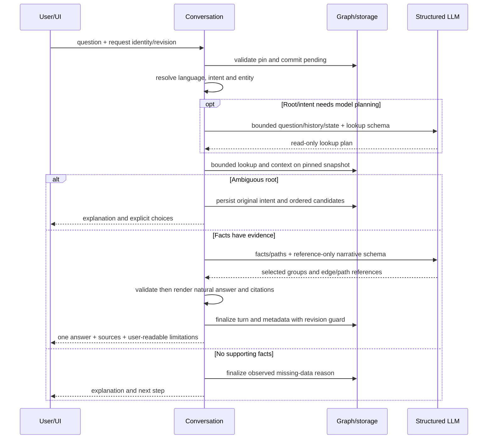

---
uid:
key: CMP-RKG-CONVERSATION
type: component
group: normative
scope: system
system: SYS-RKG
status: draft
revision: 10
change_set: CHG-RKG-2026-004
ownership: {accountable_team: TEAM-RKG, accountable_role: architect}
relations: {realizes: [CAP-RKG-003], constrained_by: [NFR-RKG-REL-001, NFR-RKG-SEC-001]}
classification: internal
ai_assisted: true
---
# CMP-RKG-CONVERSATION — Conversation and LLM component

Revision 6 aligns the heading with the key and filename. `approval-005` pin revision 3. Revision 4 tự ghi `approved` nhưng không có
approval record cho revision đó. Revision 5 chỉ bổ sung sequence và failure
mode từ behavior đã có; nó không phải approval mới.

## Responsibilities

Điều phối conversation/turn/state, pin repository/snapshot, build bounded history, validate
provider plan, gọi read-only retrieval qua `CMP-RKG-GRAPH` và validate citation
trước finalize. Persist turn/state trên cùng Kùzu DB qua storage façade/schema do
`CMP-RKG-GRAPH` sở hữu — không tự quản lý migration hay writer process riêng.

## Internal structure

Service tạo conversation, pin snapshot, nhận turn và gọi provider. Persist đi
qua storage của `CMP-RKG-GRAPH`. Retrieval đọc graph đã pin. Provider không ghi
fact.

## Sequence

Create pin snapshot được chỉ định, hoặc active snapshot khi request bỏ
`snapshot_id` (`409 no_active_snapshot` nếu không có active). Turn ghi pending,
nhả write transaction, gọi provider, rồi finalize trong transaction revision
guard. Retrieval đi qua `CMP-RKG-GRAPH` và chỉ đọc.

## Failure mode

Thiếu hoặc sai `expected_revision` / `client_request_id` theo validation hiện
tại trả lỗi request hoặc `conversation_conflict`, và không ghi đè focus.
`conversation_busy` chặn xóa khi còn turn pending. Provider tắt, timeout hoặc
output hỏng không tạo graph fact. Không có active snapshot khi tạo conversation
không tự chọn snapshot khác.

## Transaction boundary

Commit pending turn rồi release write transaction trước provider call. Finalize trong
transaction riêng với revision guard.

## Idempotency

`(conversation_id, client_request_id)` unique;
cùng key khác body trả conflict.

## Concurrency

Hai turn cùng lúc trên một conversation xếp theo revision. `expected_revision` lệch
trả conflict và không ghi đè focus. Turn `pending` chặn xóa conversation cho đến
khi recovery. Provider chạy sau khi write transaction của pending đã nhả.

## Provider boundary

Model-call/token/graph-operation/turn-deadline/question-character ceilings không được áp dụng mặc định theo CHG-RKG-2026-003. Usage vẫn được đo; schema validation, history/retrieval bounds và provider error handling bắt buộc. Provider output
không được chạy như arbitrary code/query hoặc ghi thành graph fact.

## Conversational answer design — CHG-RKG-2026-002

Revision 7 selects ADR-2026-007 option B for AC-RKG-074…081. This is a design
candidate, not a statement that runtime implements the new behavior or that
Architecture Gate is approved. Historical approval-005 stays bound to its old pins.

### Internal structure

- Language resolver chooses vi/en using explicit language signals, including
  unaccented Vietnamese; ambiguous text uses UI locale, absent locale defaults vi.
  Code identifiers and method/path are excluded from language detection.
- Root resolver uses explicit selection, ordered pending candidates and follow-up
  focus first; method/path is parsed conservatively, endpoint intent filters
  Endpoint before name lookup. A matching HTTP method/path must be exact against
  endpoint attributes. Path-only and name collisions request clarification.
- Schema-bound planner is used when lookup cannot be determined locally; it may
  propose query/type/intent in the read-only allowlist, never arbitrary queries.
- Intent retrieval distinguishes connector handled_by from relations being asked
  about. For endpoint calls, traverse to handler then outgoing calls; for caller
  questions use incoming calls. Connector and relations share one context budget
  and count as one build_context operation, not an unbounded series of model tools.
- Narrative selector chooses reference-based sections and ordered paths from
  supported facts. Backend checks membership, continuity, direction, root reachability
  and evidence, then renders full Vietnamese/English sentences and direct/indirect
  groups. Endpoint→handler is introduction, not a calls claim.
- Terminal persistence includes language and limitation information; clarification
  persistence includes the original redacted question/intent, language and stable
  candidate order. Physical/wire fields await L3 readiness, not an implicit migration.

### Sequence

Greeting-only, when provider is available and snapshot/session checks pass, uses
local safe guidance without model/graph calls and keeps focus/pending intent.
Greeting with a domain question takes the normal sequence. Provider-disabled state
remains disabled; it is not bypassed by pretending a Q&A answer succeeded.

### Failure mode

- No entity match is not proof the endpoint does not exist. No supported relation
  is not proof of no runtime calls. Truncation is explicit, including after reload.
- Wrong/missing method, multiple matches or planner uncertainty never auto-select.
- Schema, ID, path or direction failure rejects provider output. Fallback renderer
  is only for independently validated facts; it cannot repair foreign IDs or
  pretend unverified free prose is grounded. No extra paraphrase call is permitted.
- Invalid ordinal retains choices. Valid ordinal resumes pending intent, not the
  numeric reply text. An explicit new entity/topic replaces pending intent.
- Legacy metadata absent is unknown; history UI must not report full coverage.
- Evidence unavailable is reported; do not substitute another evidence of the same
  entity or silently repin. Existing provider errors keep committed focus.

### Transaction boundary, idempotency and concurrency

The existing pending/finalize boundary remains. Pending intent is persisted in the
same terminal transaction as needs_clarification and its ordered candidates. Answer,
validated facts/citations, locale and limitation metadata finalize atomically;
provider/network work runs outside the write transaction. Invalid request or stale
revision writes nothing. Pending recovery after restart keeps committed state.

Request equality must include any effective language override added by L3. Same
client_request_id and same semantic input replays the persisted answer/metadata
without recomputation or a second provider call; changed semantic input conflicts.
Exactly one pending turn per conversation remains enforced by storage/revision
checks. A greeting does not erase pending clarification; successful explicit topic
change updates it atomically. Candidate state is read from the committed revision.

### Validation and ownership

Graph component continues to own schema, immutable snapshot and bounded read API;
conversation owns the read plan, narrative validation and redacted turn result.
No new analyzer or graph fact writer is introduced. Calls obey NFR-RKG-REL-001.
AC-RKG-074…081 add natural-answer and usable-source checks to existing ACs.
Contract, browser and live quality evidence are not_run for this draft revision.

## Provider selection — CHG-RKG-2026-004

Server-only `RKG_LLM_PROVIDER` selects `openrouter` (default, backward compatible)
or `openai` (direct official Chat Completions endpoint). Each adapter uses only
its own server API key/model settings. Missing selected key is `llm_disabled`,
regardless of the other key; no automatic fallback or client endpoint override.
Invalid selector fails server initialization with safe `llm_invalid_request`;
the CLI returns exit1 and a safe JSON error code without a traceback.
Both fixed-endpoint transports reject every redirect without forwarding credentials.
Provider capabilities expose local selected-key availability only. Injectable
synthetic providers retain the existing testing boundary.

OpenAI uses strict JSON-schema Structured Outputs and `store=false`, without
OpenRouter-only routing/usage extensions. Wire projection removes artifact
annotations (`$schema`, `$id`, `x-aide`), `uniqueItems` and string-length
constraints (`minLength`, `maxLength`); all-string enums gain
their equivalent string type. Original model schemas remain unchanged and must
validate every returned value locally, including uniqueness and string lengths.
String lengths are omitted conservatively because documented base-model wire
support is ambiguous; numeric/array bounds remain on the wire. The coordinator
still validates graph IDs, topology and evidence before rendering. Refusal and
malformed choice/message/content fail closed through the existing safe codes.
No application budget ceiling is restored; existing history/retrieval limits stay.

This revision is an implementation candidate. Source and Component Merge gates
remain pending; previous approvals do not approve this revision. Live provider
quality and credential/model availability require separate operator verification.
