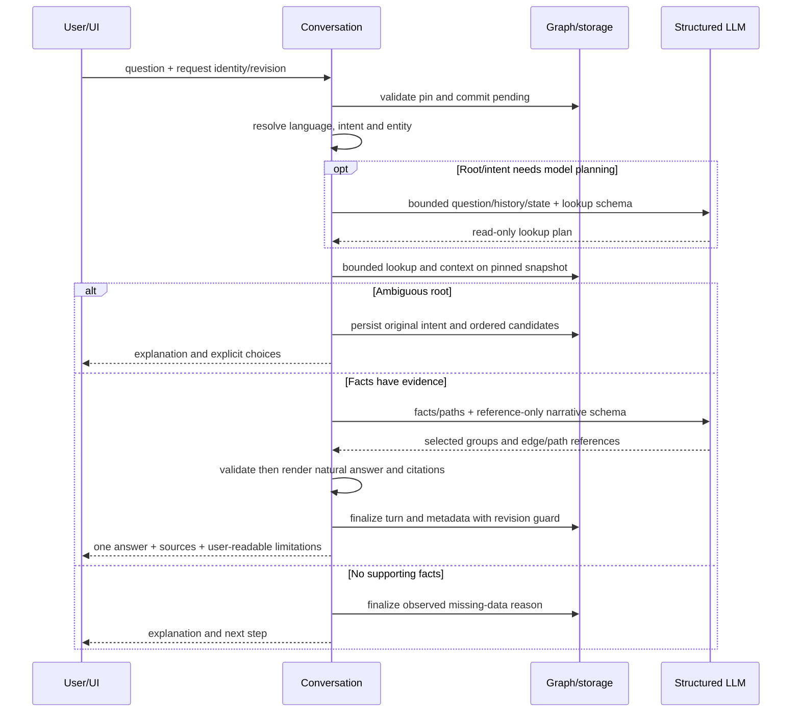

---
{
  "key": "AVW-RKG-CHATBOT-002-r2",
  "type": "architecture-view",
  "group": "derived",
  "revision": 1,
  "non_normative": true,
  "hand_written": false,
  "derived_from": [
    "BL-CHG-RKG-2026-002-r2"
  ],
  "generator": "tools/render_chatbot_review.py",
  "generator_sha256": "de028fa02b3f1c0d7bec4c32af84e968056db54ce28a8e01ee9916b4ba6cb65d",
  "source_hashes": {
    "FR-RKG-005": "6f240da74dd108933c85da36bf973106c30b7a6825f2e3b57e67318fa22a78f5",
    "ADR-2026-007": "c699b29aa4c36c4be71c40b9f179731213f2f53e77d811a06e9307a2be68144c",
    "CMP-RKG-CONVERSATION": "2b2bc1bb8c3cc17cc2349d5c3be07b828efd89cbc24660cfba2c44635adffa65",
    "CMP-RKG-WEB": "9127465096842ccdf6addff5649a13839515f088a136d2bdcbbb3e5ccb5b91e6",
    "TM-RKG": "c22e337412e5c9d42bccbc5cf5ef76e92767ee130f3b4d8a9de86ea6d6570bb6",
    "UXF-RKG-002": "5e57d4c6d118e1463a96373740105d61371514de12f2f1aa17a303206d8e3add",
    "SCR-RKG-001": "385e3bd7ddb7ff32397580270005574cb6cce2ae47e392e7b137c9a4520876c3",
    "UID-RKG-001": "b5b92b6652c087cadaa0a347de226f9bf72fc2f5ad36eff617e9452b4e3dbc7e",
    "GATE-RKG-SCOPE": "bf7f2fb25f44a09f6ce42a3f937a5e125abe4cf184789b0eb9e9e5f304a2ed17",
    "GATE-RKG-ARCHITECTURE": "28b9cefd31d2573bee4b5be4a8a23c9e649e458ee97605f96972dd53b6d60826",
    "GATE-RKG-UIUX": "9738d79480c08191b7043a58e50001d3bc0e1e7f501631250a9ddab52be86a34",
    "PRD-RKG": "6406762c3f72ed86601b16711a105408be90b72389891e66dd4642b4ecbc25cc",
    "DOM-RKG-CORE": "24759954cd15951c3c6fc441d0ba0b88d831f62f86ee1e5b1c15db74318d2ff3",
    "CAP-RKG-003": "a83f81a79c97a82bb302f0db2a28ade53e32299b390d45a2318ae33839c57c93",
    "CMP-RKG-GRAPH": "7792b51117fd0d302a1e1d485e06f68f01266a151fe3bf94220ddddb17c6cbb2",
    "CMP-RKG-TRANSPORT": "6d89ca2098b2335b8455b3dad6c2b0a214079e55cd92e13d5cbf0de13e6df286",
    "ADR-2026-001": "ee392713079ebeb4904445a033ce7b5bdfd417a85cfc20e4bac8bde23442c10d",
    "ADR-2026-004": "43ade7152dac2960329b8dd0a196649e91a317c125133a53e7e26164d5f4e3e3",
    "NFR-RKG-SEC-001": "ea54ad8b488bc6bcc862ed0316dc8e6a46a58ad63119b9cadf3d24853d8135aa",
    "NFR-RKG-REL-001": "fd6742188c96da8e9859bbd15ff68715c792e57d6eaf6368d34e3d34dd902b0b",
    "NFR-RKG-UX-001": "c73044ee84ad7fda785daf4ad9818e128d5cf33e02005b00f8019668f09be4e3",
    "API-RKG-CORE-v1": "e0f482a8c98a88898aa7abae2d42e1c00cb82b0e393627447dd7f08fd03d8ce2",
    "TBL-RKG-GRAPH": "8f89df7b938dec9947a06f49fb307432b9182853ca5e4bfdcad1994a50d13bcf",
    "UIS-RKG-001": "2e66ba300e0b4e1e9fb55ccb0a1f7d376967603ad673e3bc1df339e563e7749b",
    "EVAL-RKG-QA-001": "19bba2089b095b0b431d85d843a61a3d5a4488889c269d47439869f11b673720",
    "OBS-RKG-005": "82acb6483ca288e1952b5f7f354158243ea07ea45cf090a62392787e3c92ef3f",
    "TOK-RKG-001": "ae71b14d8921b6e64f03641a5787c7b99622fa3f28904a75208eabfb32c8de96"
  }
}
---

# AVW-RKG-CHATBOT-002-r2 — Chatbot dễ hỏi và trả lời tự nhiên

> Khi view và artifact normative bất đồng, **artifact normative thắng**.

> Candidate cho review; không phải approval hoặc bằng chứng triển khai.

## Source: ADR-2026-007

# ADR-2026-007 — Structured conversational answers over verified graph facts

## Vấn đề và ràng buộc

Câu trả lời nối các cạnh graph khó đọc, lẫn lời gọi trực tiếp/gián tiếp, và buộc
người dùng biết tên kỹ thuật. Cần dễ hiểu hơn mà vẫn local-first, read-only,
không nhận raw source và không vượt ngân sách ở NFR-RKG-REL-001. Citation ID hợp
lệ chưa đủ chứng minh diễn giải tự do đúng. Invariant evidence-first của
ADR-2026-001 và immutable snapshot của ADR-2026-004 tiếp tục áp dụng.

## Tiêu chí quyết định

1. Kiểm chứng được từng quan hệ và đường đi, gồm source/target/direction/evidence.
2. Người dùng đọc được lời giải thích và phân biệt endpoint, handler, direct/indirect.
3. Không thêm model call cho paraphrase hoặc đưa model quyền truy vấn tùy ý.
4. Có fallback an toàn, replay ổn định và tương thích transcript cũ.
5. Tiếng Việt không dấu và clarification không làm mất ý định gốc.

## Phương án và đánh đổi

| Phương án | Điểm mạnh | Giới hạn |
|---|---|---|
| A: backend tự nhóm facts, model chỉ chọn edges | Grounding đơn giản, rollout nhỏ | Thiếu linh hoạt về thứ tự, trọng tâm và đường đi |
| B: model chọn cấu trúc trình bày có edge/path IDs; backend kiểm tra và diễn đạt | Dễ đọc, chọn đúng trọng tâm, kiểm chứng bằng dữ liệu | Cần validate topology và renderer Việt/Anh; không phải văn bản tự do của model |
| C: model viết toàn bộ answer tự do kèm citation | Linh hoạt về văn phong | Citation/schema không bảo đảm entailment; chưa có kiểm tra đáng tin trong budget hiện hành |

## Quyết định nội dung

Chọn B theo ủy quyền chốt nội dung của người khởi tạo, dùng A làm fallback cho
facts/path đã được kiểm tra khi không cần model quyết định bố cục. B là lựa chọn
thiết kế của bản draft; Architecture Gate chưa được ký cho revision/hash này.
Không có `supersedes`: quyết định này mở rộng conversation trong bounded context
hiện có, không thay foundation ADR. Tier đề xuất là T2; cần xác nhận ở review.

Model chỉ trả cấu trúc gồm root/reference, nhóm quan hệ và ordered edge IDs của
đường đi. Không có field free-form factual `answer`. Schema chi tiết và compatibility
được chốt ở L3 sau các gate phía trước; không expose internal plan cho browser.
Backend tạo câu đầy đủ và đoạn dẫn giải từ các quan hệ đã validate, thay câu
`A calls B` riêng lẻ bằng nhóm câu có chủ thể, thứ tự và vai trò trực tiếp/gián tiếp.

Endpoint dùng `handled_by` làm cầu nối tới Callable; quan hệ `calls` bắt đầu từ
handler. Connector không bị loại bởi bộ lọc quan hệ cần trả lời và không bị render
nhầm thành lời gọi. Incoming/outgoing xác định theo ý định và được kiểm tra lại;
không dùng neighborhood hai chiều mặc định rồi xem mọi edge là callee.

Mỗi path phải nối liên tục theo direction đã yêu cầu, cùng repository/snapshot,
root đúng và mọi edge có evidence trong context. Path có cạnh ngoài context,
đảo chiều, đứt đoạn hoặc vòng lặp không được publish như một chuỗi gọi. Tên ngắn
chỉ dùng khi phân biệt được; collision mở rộng qualified name, không đổi entity ID.

Unknown/foreign ID, output malformed và direction/path sai fail-closed bằng lỗi
provider hiện có. Không dùng fallback để hợp thức hóa output vi phạm schema hoặc
không có bằng chứng. Fallback A dùng cùng validated facts, không gọi thêm provider.

## Ngôn ngữ, greeting và clarification

Ngôn ngữ: dấu hiệu Việt rõ (kể cả không dấu) → vi; dấu hiệu Anh rõ → en; nếu không
đủ dấu hiệu dùng locale UI, client cũ không gửi locale mặc định vi. Method/path và
identifier không tính là tín hiệu ngôn ngữ. Ngôn ngữ được xác định trước answer
renderer; lựa chọn ordinal kế thừa ngôn ngữ/câu hỏi gốc đang chờ.

Greeting-only trên hội thoại ready được xử lý bằng hướng dẫn cố định theo locale,
không truy vấn graph/gọi model/đổi focus. Greeting kèm câu hỏi nghiệp vụ vẫn là Q&A.
Provider disabled/timeout và snapshot/session guards vẫn theo contract hiện có.

Clarification lưu câu hỏi/ý định đã redact và candidate IDs đúng thứ tự. Chọn bằng
nút/số tiếp tục intent gốc; invalid ordinal giữ pending list. Câu hỏi explicit mới
thay pending intent. Reply "2" không được dùng làm câu hỏi đầu vào cho synthesis.

## Persistence, rollout và failure

Answer đã render, claims/citations đã validate và metadata locale/limitations phải
được lưu cùng terminal turn. Conversation pending intent được lưu transactionally
cùng ordered candidates. L3 đánh giá fit của các JSON columns hiện có và migration
nếu cần; không tự thêm DDL hay lạm dụng metric counter để chứa metadata.

Không backfill hoặc viết lại answer/citation của turn cũ. Legacy metadata absent
được coi là unknown, không được gán `truncated=false`. Provider lỗi không đổi focus
đã commit. Trạng thái error và nội dung UI dùng wording riêng, không giả thiếu graph.

## Verification và giới hạn

AC-RKG-074…081, AC-RKG-024/025/028…033/041/042/046/047/059/063/064; live quality
đánh giá theo EVAL-RKG-QA-001, không suy ra từ mock/schema test. Factual renderer
không diễn giải thân hàm hay nghiệp vụ ngoài facts. Natural answer ở đây là câu
Việt/Anh rõ, nhóm và dẫn giải quan hệ, không phải giải thích toàn bộ source.
UI/UX readability cần người dùng đi luồng; chưa có test/approval triển khai cho ADR này.

## Source: CMP-RKG-CONVERSATION

# CMP-RKG-CONVERSATION — Conversation and LLM component

Revision 6 aligns the heading with the key and filename. `approval-005` pin revision 3. Revision 4 tự ghi `approved` nhưng không có
approval record cho revision đó. Revision 5 chỉ bổ sung sequence và failure
mode từ behavior đã có; nó không phải approval mới.

## Responsibilities

Điều phối conversation/turn/state, pin repository/snapshot, build bounded history, validate
provider plan, gọi read-only retrieval qua `CMP-RKG-GRAPH` và validate citation
trước finalize. Persist turn/state trên cùng Kùzu DB qua storage façade/schema do
`CMP-RKG-GRAPH` sở hữu — không tự quản lý migration hay writer process riêng.

## Internal structure

Service tạo conversation, pin snapshot, nhận turn và gọi provider. Persist đi
qua storage của `CMP-RKG-GRAPH`. Retrieval đọc graph đã pin. Provider không ghi
fact.

## Sequence

Create pin snapshot được chỉ định, hoặc active snapshot khi request bỏ
`snapshot_id` (`409 no_active_snapshot` nếu không có active). Turn ghi pending,
nhả write transaction, gọi provider, rồi finalize trong transaction revision
guard. Retrieval đi qua `CMP-RKG-GRAPH` và chỉ đọc.

## Failure mode

Thiếu hoặc sai `expected_revision` / `client_request_id` theo validation hiện
tại trả lỗi request hoặc `conversation_conflict`, và không ghi đè focus.
`conversation_busy` chặn xóa khi còn turn pending. Provider tắt, timeout hoặc
output hỏng không tạo graph fact. Không có active snapshot khi tạo conversation
không tự chọn snapshot khác.

## Transaction boundary

Commit pending turn rồi release write transaction trước provider call. Finalize trong
transaction riêng với revision guard.

## Idempotency

`(conversation_id, client_request_id)` unique;
cùng key khác body trả conflict.

## Concurrency

Hai turn cùng lúc trên một conversation xếp theo revision. `expected_revision` lệch
trả conflict và không ghi đè focus. Turn `pending` chặn xóa conversation cho đến
khi recovery. Provider chạy sau khi write transaction của pending đã nhả.

## Provider boundary

Tối đa hai model calls/turn; timeout/token/schema limits bắt buộc. Provider output
không được chạy như arbitrary code/query hoặc ghi thành graph fact.

## Conversational answer design — CHG-RKG-2026-002

Revision 7 selects ADR-2026-007 option B for AC-RKG-074…081. This is a design
candidate, not a statement that runtime implements the new behavior or that
Architecture Gate is approved. Historical approval-005 stays bound to its old pins.

### Internal structure

- Language resolver chooses vi/en using explicit language signals, including
  unaccented Vietnamese; ambiguous text uses UI locale, absent locale defaults vi.
  Code identifiers and method/path are excluded from language detection.
- Root resolver uses explicit selection, ordered pending candidates and follow-up
  focus first; method/path is parsed conservatively, endpoint intent filters
  Endpoint before name lookup. A matching HTTP method/path must be exact against
  endpoint attributes. Path-only and name collisions request clarification.
- Schema-bound planner is used when lookup cannot be determined locally; it may
  propose query/type/intent in the read-only allowlist, never arbitrary queries.
- Intent retrieval distinguishes connector handled_by from relations being asked
  about. For endpoint calls, traverse to handler then outgoing calls; for caller
  questions use incoming calls. Connector and relations share one context budget
  and count as one build_context operation, not an unbounded series of model tools.
- Narrative selector chooses reference-based sections and ordered paths from
  supported facts. Backend checks membership, continuity, direction, root reachability
  and evidence, then renders full Vietnamese/English sentences and direct/indirect
  groups. Endpoint→handler is introduction, not a calls claim.
- Terminal persistence includes language and limitation information; clarification
  persistence includes the original redacted question/intent, language and stable
  candidate order. Physical/wire fields await L3 readiness, not an implicit migration.

### Sequence



Greeting-only, when provider is available and snapshot/session checks pass, uses
local safe guidance without model/graph calls and keeps focus/pending intent.
Greeting with a domain question takes the normal sequence. Provider-disabled state
remains disabled; it is not bypassed by pretending a Q&A answer succeeded.

### Failure mode

- No entity match is not proof the endpoint does not exist. No supported relation
  is not proof of no runtime calls. Truncation is explicit, including after reload.
- Wrong/missing method, multiple matches or planner uncertainty never auto-select.
- Schema, ID, path or direction failure rejects provider output. Fallback renderer
  is only for independently validated facts; it cannot repair foreign IDs or
  pretend unverified free prose is grounded. No extra paraphrase call is permitted.
- Invalid ordinal retains choices. Valid ordinal resumes pending intent, not the
  numeric reply text. An explicit new entity/topic replaces pending intent.
- Legacy metadata absent is unknown; history UI must not report full coverage.
- Evidence unavailable is reported; do not substitute another evidence of the same
  entity or silently repin. Existing provider errors keep committed focus.

### Transaction boundary, idempotency and concurrency

The existing pending/finalize boundary remains. Pending intent is persisted in the
same terminal transaction as needs_clarification and its ordered candidates. Answer,
validated facts/citations, locale and limitation metadata finalize atomically;
provider/network work runs outside the write transaction. Invalid request or stale
revision writes nothing. Pending recovery after restart keeps committed state.

Request equality must include any effective language override added by L3. Same
client_request_id and same semantic input replays the persisted answer/metadata
without recomputation or a second provider call; changed semantic input conflicts.
Exactly one pending turn per conversation remains enforced by storage/revision
checks. A greeting does not erase pending clarification; successful explicit topic
change updates it atomically. Candidate state is read from the committed revision.

### Validation and ownership

Graph component continues to own schema, immutable snapshot and bounded read API;
conversation owns the read plan, narrative validation and redacted turn result.
No new analyzer or graph fact writer is introduced. Calls obey NFR-RKG-REL-001.
AC-RKG-074…081 add natural-answer and usable-source checks to existing ACs.
Contract, browser and live quality evidence are not_run for this draft revision.

## Source: CMP-RKG-WEB

# CMP-RKG-WEB - React web application

React + Vite UI: repository management, snapshot history/lifecycle,
onboarding/job/Explorer/evidence/dependency/technology thuộc
`CAP-RKG-002`; conversation workspace thuộc `CAP-RKG-003`. Data client tách
mock/live nhưng dùng cùng types; UI không giữ bản sao authoritative của
graph/history. Explorer có thêm nút Structure; cây đọc từ search của snapshot,
không bản sao graph và không surface mới.
Job monitor poll theo contract và dừng khi terminal/unmount; Q&A hiển thị pending,
timeout/error rõ ràng thay vì giả lập token streaming.

## Internal structure

Pages cho repository, job, Explorer và conversation dùng một `RkgClient`. Live
client map wire JSON, gồm `Namespace` ↔ UI `module`. Mock client dùng cùng type.
Structure tree là projection trên kết quả search, không phải store thứ hai.

## Sequence

Shell chọn repository rồi gọi live hoặc mock client cùng type. Repository form,
detail, job monitor, Explorer và conversation đều đọc API của snapshot hoặc
repository đang chọn. Structure ghép entity trả về thành cây hiển thị; không
giữ graph riêng.

## Failure mode

Lỗi API giữ form đang sửa khi contract nói giữ draft (`invalid`, conflict,
network). Job `409 index_job_busy` không tạo job thứ hai trên UI. Poll dừng khi
job terminal hoặc view unmount. Không có token streaming để che timeout.

## Transaction boundary

Trình duyệt không giữ bản ghi graph hay conversation. Mọi thay đổi đi qua lệnh API.
UI không mở transaction storage.

## Idempotency

Không phải mutation nào cũng gửi `expected_revision` hoặc `client_request_id`.

- `PATCH /repositories/{id}` gửi `expected_revision`. `409 repository_conflict`
  giữ form.
- `POST /conversations/{id}/turns` gửi `client_request_id` và
  `expected_revision`.
- `POST /repositories`, `DELETE /repositories/{id}`,
  `POST /repositories/{id}/index-jobs`, activate/delete snapshot, và
  create/delete conversation không gửi hai field đó.

UI không gộp hai lần ghi xung đột thành một.

## Concurrency

Poll job dừng khi job terminal hoặc view unmount. Hai tab không chia sẻ authority
trong bộ nhớ. Mỗi request gắn repository và snapshot đang chọn.

## Directory presentation

Graph/List/search/Structure use the same canonical Directory API identity. Structure
must not synthesize a second selectable node for an existing Directory path. Details
show relative path and structural evidence without source excerpts. API của
snapshot cũ vẫn trả `Namespace`. Client map `Namespace` sang type UI `module`
và map ngược `module` thành `Namespace` khi search. `structureTree` gộp
`Namespace` và `SourceUnit` cùng file thành một node file. Mapping này là
projection lúc hiển thị; không đổi ID lưu trong snapshot. Directory hiển thị
như folder với nhãn thư mục đã bản địa hóa.

## Conversational presentation — CHG-RKG-2026-002

Revision 9 selects the presentation in ADR-2026-007 / UXF-RKG-002 for
AC-RKG-074…081. It is a review candidate; live runtime is not changed by this spec.

### Structure and sequence

UI sends an explicit vi/en preference as defined by the future L3 contract. Backend
language wins for the answer; UI chrome follows UI locale. Switching UI locale
must not rewrite old answers. After submit and after reload, render the same stored
answer, source references and limitation state. Never infer missing persisted flags
as false or recompute an old answer in the browser.

Conversation bubble has one natural answer first, source controls with readable
labels, then a secondary collapsed details region for qualified names/relations.
Claims are retained for verification/inspection but are not printed a second time
by default. Insufficient evidence uses the server explanation once, with a localized
fallback only if no answer exists. Dynamic status must not announce duplicate text.
Clarification explains ambiguity and shows ordered options with type and safe
method/path or relative module metadata. Selecting one continues original intent.

### Failure and source handling

Translate technical errors/limitation codes to outcome and next action. Show partial
coverage beside answer; raw codes are secondary details. Historical missing metadata
is labeled unknown, not complete. Provider errors keep draft/history; unavailable
snapshot disables submit and marks sources unavailable without retargeting.

Citation controls use edge/evidence identity, not just target entity. Resolve the
requested evidence in the pinned snapshot and show only its safe relative location;
if entity detail cannot supply it, show unavailable rather than another evidence.
Physical line markers are omitted for filesystem provenance. All text is escaped,
no raw source/HTML/model free prose is trusted. Existing a11y/dialog focus rules apply.

### Transaction, idempotency and concurrency

The browser is not a persistence authority. Transport contract owns payload shape;
mock/live client and types must move together once Contract Gate is ready. All turn
requests keep client_request_id/expected_revision, and L3 must include language in
semantic replay equality. Pending locks duplicate submit/delete, not historical
source access. Conflict keeps draft and requires intentional reload/retry.

## Source: TM-RKG

# TM-RKG — Threat model

| Threat | Boundary | Control | Verification |
|---|---|---|---|
| Malicious source executes | ingestion/analyzer | Structured parser + metadata allowlist; never import/build/install | `TEST-RKG-SCAN-SAFE`, `TEST-RKG-SYNTAX-DIAGNOSTIC` |
| Path/symlink escape | local source/workspace | canonical root check; no external link traversal | `TEST-RKG-SOURCE-BOUNDARY`, `TEST-RKG-LOCAL-ONBOARDING-E2E` |
| Secret disclosure | graph/report/log/provider | never read `.env`; redact; omit values/payload/query | `TEST-RKG-CONFIG`, `TEST-RKG-CONVERSATION-REDACTION` |
| Prompt injection | repository/model text | bounded instructions; schema; read-only query allowlist | `TEST-RKG-QA-INJECTION` |
| Stored/reflected XSS | UI | render text; sanitize Markdown; no source HTML execution | `TEST-RKG-CONVERSATION-A11Y`, `TEST-RKG-UI-VISUAL-A11Y` |
| Snapshot/history mix-up | storage/conversation | snapshot IDs, pinning, referential validation | `TEST-RKG-REINDEX`, `TEST-RKG-SNAPSHOT-PIN`, `TEST-RKG-SNAPSHOT-RETENTION` |
| Cross-repository IDOR/cascade | API/storage | validate repository ownership before read/mutation; repository-scoped transaction/delete | `TEST-RKG-REPOSITORY-ISOLATION`, `TEST-RKG-REPOSITORY-DELETE-GUARD` |
| Repository locator disclosure or substitution | API/UI/storage | immutable source identity; canonical validation; redact locator/error/log | `TEST-RKG-REPOSITORY-CRUD`, `TEST-RKG-REPOSITORY-UPDATE` |
| Unauthorized local mutation | API | loopback, session token, Origin validation | `TEST-RKG-LOCAL-SESSION`, `TEST-RKG-INDEX-SESSION` |
| Dependency confusion / poisoned package metadata | ingestion/analyzer | metadata chỉ là dữ liệu; không install/import; provenance + local-shadow checks | `TEST-RKG-PKG-INVENTORY`, `TEST-RKG-DETECT-NEG` |
| Kùzu workspace disclosure or concurrent corruption | filesystem/storage | server-owned path, restrictive host permissions, one application worker, atomic publication + backup/migration tests | `TEST-RKG-INDEX-SINGLE-WRITER`, `TEST-RKG-REINDEX`, migration fixture planned by Contract Gate |

## Residual risks

Static analysis can miss dynamic relationships; compromised local account can access
the single-user service; configured external LLM receives only explicitly permitted
bounded context. UI and reports must communicate these limitations.

## Structured conversational explanation risks — CHG-RKG-2026-002

Revision 8 adds controls for ADR-2026-007; it is draft pending exact-hash review.
Existing controls and historical evidence remain applicable only to their pinned
revisions, not proof of this future behavior.

| Threat | Boundary | Required control | Planned verification |
|---|---|---|---|
| Fluent prose adds unsupported meaning despite valid citation | narrative selection/render | Reference-only model structure; backend factual renderer, no free-form answer field; check edge meaning/direction/path | TEST-RKG-CONVERSATIONAL-QA |
| Reversed or disconnected path presented as indirect call | graph→narrative | Root reachability, path continuity, evidence membership, cycle handling, direct/indirect labeling | TEST-RKG-CONVERSATIONAL-QA |
| Endpoint/handler alias silently chooses wrong subject | lookup | Exact method/path; Endpoint intent restriction; explicit clarification for collisions | TEST-RKG-CONVERSATIONAL-QA |
| Ordinal selection or greeting loses pending intent | conversation state | Persist redacted original intent/candidate order atomically; preserve focus on greeting/provider failure | TEST-RKG-CONVERSATIONAL-QA |
| Citation opens unrelated entity evidence | answer→UI | Resolve exact evidence_id in pinned snapshot; unavailable if missing, never substitute evidence | TEST-RKG-CONVERSATIONAL-UI |
| Reload conceals truncated/unknown context | storage→UI | Persist limitation state; absent legacy metadata is unknown; no false completeness claim | TEST-RKG-CONVERSATIONAL-UI |

Model output remains untrusted and cannot authorize tools/queries or create graph
facts. No new provider data class is allowed: bounded redacted question/history,
identities and supported facts only; never raw source/config/transcripts in evidence.

## Source: UXF-RKG-002

# UXF-RKG-002 — Grounded conversation flow

## Mục tiêu và điều kiện

Cho phép hỏi đáp Việt/Anh nhiều lượt trên một repository/snapshot được pin, trong
khi citation và limitation luôn kiểm chứng được. Luồng chỉ bật khi LLM provider khả
dụng và snapshot còn đọc được; Explorer/search không phụ thuộc điều kiện này.

## Luồng chính

1. Người dùng tạo conversation trên active snapshot của repository hiện tại hoặc mở conversation cũ.
2. UI hiển thị pinned repository/snapshot/focus và gửi question với request ID/revision.
3. Pending state khóa submit trùng và cho biết provider đang xử lý.
4. Answer hiển thị claim/citation; click citation mở evidence panel.
5. `needs_clarification` hiển thị ordered candidates; người dùng chọn hoặc trả lời text.
6. Follow-up dùng focus/pending state; explicit entity mới thay focus.
7. Conflict cho reload/retry có chủ đích; provider error giữ state thành công trước đó.
8. Xóa conversation yêu cầu xác nhận, giải phóng snapshot reference và không xóa snapshot/history khác.

## Trạng thái response

| Status | Cách trình bày | Primary action |
|---|---|---|
| `answered` | Answer đã sanitize, claim/citation, limitation và dấu hiệu truncation | Mở citation hoặc hỏi tiếp |
| `needs_clarification` | Câu hỏi gốc + ordered candidate có type/qualified name | Chọn candidate hoặc trả lời text |
| `insufficient_evidence` | Nêu phần thiếu, không dùng empty answer như lỗi kỹ thuật | Mở Explorer hoặc hỏi lại hẹp hơn |
| `failed`/provider error | Giữ history đã commit và focus trước đó | Retry bằng request ID mới |
| `conflict` | Không ghi đè draft; công bố revision server | Reload conversation rồi review/retry |
| `disabled` | Giải thích provider chưa cấu hình | Dùng Search/Explorer |

## Recovery và consistency

- `409 conversation_conflict`: reload turns/revision; giữ draft ngoài transcript để
  người dùng quyết định gửi lại.
- `409 conversation_busy`: vô hiệu delete/submit trùng và tiếp tục theo dõi turn hiện tại.
- `410 snapshot_unavailable`: transcript vẫn đọc được, citation đánh dấu unavailable;
  không tự chuyển sang active snapshot mới.
- `502/503/504`: phân biệt provider error, disabled và timeout; không giả lập streaming.
- Khi `history_truncated=true` hoặc `retrieval_truncated=true`, hiển thị limitation gần
  answer, không chỉ trong metadata ẩn.
- Không ghi question/answer, session token, credential hay chain-of-thought vào log UI.

## Tiêu chí thoát

Success khi answer/clarification thuộc đúng pinned snapshot, citation mở được evidence
và follow-up dùng revision mới. Xóa conversation chỉ success sau confirm và khi không
có turn pending.

## Conversation usability — selected content for CHG-RKG-2026-002

Revision 5 describes the chosen experience for FR-RKG-005 AC-RKG-074…081.
It remains draft until UI/UX review of exact revisions. No new status enum or route
is introduced by this level-1 flow; field binding is deferred to L3/UIS.

1. Ready empty conversation shows a brief explanation and example categories:
   endpoint calls, table reads/writes and events. User may type a greeting; response
   gives guidance without graph claims. Provider-off remains visibly disabled.
2. User names method/path, endpoint or handler using familiar text. Keep repository,
   snapshot and resolved subject visible. Ambiguous names show explicit choices
   with endpoint/handler/service metadata and a reason for asking.
3. Selecting a choice resumes the original question. The transcript may record the
   selection, but the answer makes the selected subject and intent clear.
4. Answer starts with a full sentence, then direct relations; indirect paths are
   introduced separately only when supported and relevant. Names are shortened
   only if unambiguous; qualified names are available in details.
5. Show one main answer and source buttons labeled by their relative location or
   readable source ordinal. Verification claims belong in collapsed details,
   avoiding a duplicate Claims paragraph. Source opens exact evidence of that claim.
6. Insufficient data explains the observed stage: unmatched name, no supported
   relation, or incomplete context. Offer a concrete next step without claiming
   absent graph means absent runtime behavior.
7. Partial/history limits appear in plain language near answer, not just hidden
   metadata. On reload retain the stored indication; old turns without metadata
   show that coverage information was not recorded.
8. Error/conflict keeps draft and previously committed focus. Conversation deletion
   follows the existing confirmation and pending guards. No simulated streaming.

| Region/state | Primary copy/action |
|---|---|
| Greeting/empty | Explain what can be asked; focus the question composer |
| Clarification | Explain ambiguity; select one named option explicitly |
| Answered | Read explanation; open sources or ask a follow-up |
| Insufficient, no match | Suggest method/path or a more specific name |
| Insufficient, no supported relation | Explain what the current snapshot cannot establish; open Explorer |
| Partial | State result may be incomplete; suggest a narrower question |
| Provider error/disabled | Explain service problem; retry or open Explorer |
| Historical coverage unknown | State limitation metadata was not recorded; do not claim complete coverage |

Content examples for a UI mock must be synthetic and not taken from transcripts,
real source, secret/config or host paths. Every source label must be nonempty.
Language content follows AC-RKG-074; controls follow interface locale. Accessibility
uses native buttons/details, visible focus, ordered choices and dialog focus restore.

## Source: SCR-RKG-001

# SCR-RKG-001 — Screen inventory and information architecture

## Information architecture

```text
Application shell
├── Repositories
│   ├── Repository list
│   ├── Create repository
│   └── Repository detail
│       ├── Edit defaults
│       ├── Job monitor / scan report
│       └── Snapshot history / detail
├── Explorer (requires a usable snapshot)
│   ├── Search and filters
│   ├── Graph canvas + accessible list fallback
│   ├── Entity / edge / evidence drawer
│   ├── Technology / dependency / diagnostic panels
│   └── Context export
└── Ask (requires a pinned usable snapshot and configured LLM)
    ├── Conversation list
    └── Conversation workspace / citation drawer
```

Repositories là điểm vào mặc định. Explorer và Ask luôn mang context chip gồm display
name repository và snapshot ID rút gọn; route không hợp lệ phải recovery về repository
detail thay vì render graph rỗng.

## Route inventory

| Route | Screen | Entry requirement | Primary action |
|---|---|---|---|
| `/repositories` | Repository list | none | Create/open repository |
| `/repositories/new` | Repository create | local session cho submit | Create repository |
| `/repositories/:repositoryId` | Repository detail | repository tồn tại | Index hoặc open active snapshot |
| `/repositories/:repositoryId/edit` | Repository edit | current revision | Save defaults |
| `/jobs/:jobId` | Job monitor/report | job thuộc repository khả dụng | Open published snapshot hoặc retry |
| `/explorer?snapshot_id=:snapshotId` | Explorer | snapshot usable | Search/select entity |
| `/conversations` | Conversation list | optional repository/snapshot filter | Create/open conversation |
| `/conversations/:conversationId` | Conversation workspace | conversation + pinned snapshot | Send follow-up |

Route có resource không tồn tại hoặc ownership mismatch dùng generic not-found; không
hiển thị repository/snapshot metadata từ request bị từ chối.

## Screen/state inventory

| Screen/region | Primary action | Required states |
|---|---|---|
| Repository list | Create/open repository | loading, empty, ready, error, delete-confirm, delete-blocked |
| Repository create/edit | Create/update repository | initial, validating, submitting, invalid, conflict, saved |
| Repository detail | Start indexing/open active snapshot | loading, ready, no-active-snapshot, job-conflict, delete-confirm, delete-blocked |
| Job monitor | Open completed snapshot | queued, detecting, indexing, app-selection, succeeded, succeeded_with_warnings, failed |
| Scan report | Inspect result/recovery | loading, ready, warnings, failed, unavailable |
| Snapshot list/detail | Open/activate/delete snapshot | loading, empty, ready, active, unavailable, activate-error, delete-confirm, delete-blocked |
| Explorer | Select/search graph entity | no-active-snapshot, loading, empty, ready, truncated, stale/unavailable, error |
| Evidence drawer | Copy relative location | closed, loading, ready, unavailable |
| Technology panel | Inspect detection/support | loading, empty, `supported_patterns`, `detected_only`, `version_unverified`, `unsupported_version`, error |
| Dependency panel | Filter/open provenance | loading, empty, ready, paged, error |
| Diagnostic panel | Inspect warning/error | loading, empty, ready, paged, error |
| Context export | Download JSON | ready, generating, validation-error, complete, error |
| Conversation list | Create/open conversation | loading, empty, ready, delete-confirm, delete-blocked, error |
| Conversation workspace | Send follow-up | disabled, idle, pending, answered, needs_clarification, insufficient_evidence, error, conflict, snapshot-unavailable |

Các label như “Completed with warnings” chỉ là presentation copy của contract enum;
không tạo enum lifecycle thứ hai.

## Screen blueprints

### Repository list

- Header: page title, short description, primary **Add repository**.
- Toolbar: search by display name, result count; paging ở cuối list.
- Row/card: display name, redacted locator, updated time, active snapshot state,
  overflow actions. Click name mở detail; delete không nằm trên toàn bộ row.
- Empty state: giải thích “repository registration does not modify source” và CTA.
- Error state: message an toàn + Retry; không thay lỗi bằng empty state.

### Repository create/edit

- Create sections: Identity (`display_name`, `path`) và Advanced defaults
  (`source_root`, app module/symbol, scan defaults).
- Path là text input trên host chạy RKG, không phải upload/file picker ngầm hứa truy
  cập filesystem client. Helper copy nhắc allowed roots nhưng không lộ root tuyệt đối.
- Edit hiển thị source type/locator read-only; chỉ mutable defaults được submit cùng
  `expected_revision`.
- Inline error đặt cạnh field; summary ở đầu form liên kết tới lỗi đầu tiên. Submit
  giữ nguyên draft khi validation/conflict thất bại.

### Repository detail and snapshots

- Header: repository identity, redacted locator, edit menu.
- Status strip: active snapshot, last scan result, warning count; nếu chưa có active
  snapshot thì CTA **Index repository**.
- Main regions: index defaults/job action, snapshot history, scan report summary.
- Snapshot row: created time, source revision rút gọn, counts, capability state,
  active marker bằng icon + text, actions Open/Activate/Delete.
- Delete repository nằm trong danger zone cuối trang, không cạnh primary index action.

### Job monitor and scan report

- Stage stepper chỉ dùng `queued → detecting → indexing → terminal`; text/live region
  thông báo thay đổi, không animate liên tục khi reduced motion.
- Poll theo `Retry-After`, hiển thị last updated và nút manual retry chỉ khi request lỗi.
- Multiple app candidates là blocking selection trong content, không auto-select;
  technology/adapter detection nằm ở non-blocking capability panel.
- Terminal success dẫn tới snapshot; warning state đặt report trước CTA Explorer;
  failed state nêu code/recovery và xác nhận active snapshot cũ không đổi.

### Explorer

Desktop composition:

```text
┌─ App nav ─┬─ Repository / snapshot context ────────────────────────┐
│ Repos     │ Search + type filter                     Export context │
│ Explorer  ├───────────────┬─────────────────────────┬───────────────┤
│ Ask       │ Result list   │ Graph canvas / list     │ Detail drawer │
│           │ + presets     │ controls + limit badge │ Evidence/tabs │
└───────────┴───────────────┴─────────────────────────┴───────────────┘
```

- Search result luôn hiển thị type, name/qualified name và disambiguating metadata;
  chọn explicit result mới đổi root.
- Graph toolbar: direction, edge type, depth, node budget, zoom, fit selection và
  nhóm view Graph / List / Structure trên cùng một hàng nút. Truncated badge nằm cạnh budget controls.
- Node/edge selection mở detail drawer nhưng giữ focus context; close trả focus về
  selected item. List fallback cung cấp cùng selection/evidence actions.
- Technology, Dependency và Diagnostics là tabs/regions trong contextual surface,
  không phủ graph bằng modal dài.
- Export dialog tóm tắt root/budget và báo `truncated` sau khi hoàn tất.

### Conversation workspace

```text
┌─ Conversation list ─┬─ Pinned repository / snapshot / focus ──────┐
│ New conversation    │ Ordered transcript                          │
│ Search/filter       │ Explanation → sources → limits / [details]   │
│ Saved conversations │ Clarification candidates                    │
│                     ├──────────────────────────────────────────────┤
│                     │ Question composer                    Send    │
└─────────────────────┴──────────────────────────────────────────────┘
```

- Composer có label, remaining-character hint và submit disabled reason; Enter/line
  break behavior được công bố, không chặn IME tiếng Việt.
- Pending tạo một status region, khóa duplicate submit/delete nhưng không khóa đọc
  history/citation đã có. Không giả lập token streaming.
- Citation là button có accessible name, mở evidence drawer và chỉ hiển thị relative
  locator. Clarification candidates là ordered radio/list options, không auto-select.
- Snapshot mới chỉ tạo notice + action tạo conversation mới; conversation hiện tại
  không đổi pin.

## Responsive behavior

| Width | Navigation | Main content | Contextual detail |
|---|---|---|---|
| 1440 px | 240 px persistent rail | 12-column, graph ưu tiên | 360 px persistent drawer |
| 1024 px | compact rail | result list có thể collapse | overlay drawer không che trigger |
| 768 px | top bar + menu | two-region stack | side sheet/full-height dialog |
| 375 px | top bar | single-column route/stack | dedicated detail route hoặc bottom sheet |

Ở mobile, table đổi thành card/detail stack; chỉ graph canvas được horizontal pan.
Graph controls có touch target tối thiểu 44×44 px và list fallback luôn khả dụng.

## Shared accessibility and content rules

- Có skip link tới main content; một `h1`/screen và heading hierarchy tuần tự.
- Tab order bám visual order; focus ring không bị clip; loading không lấy focus tự động.
- Status dùng polite live region; validation/destructive failure dùng alert phù hợp.
- Skeleton/placeholder có accessible label hoặc ẩn khỏi accessibility tree; không đọc
  từng skeleton cell.
- Empty/error copy gồm điều gì xảy ra, phạm vi ảnh hưởng và một hành động phục hồi.
- Không dùng emoji làm icon; một bộ SVG icon có accessible name hoặc `aria-hidden`.

## Conversation workspace refinement — CHG-RKG-2026-002

Revision 9 replaces the old visible Answer→Claims sequence for Ask with:

```text
Pinned repository / snapshot / selected endpoint or handler
Question
Natural explanation
  Direct relations first → relevant verified indirect paths
  Sources: readable relative location / source ordinal
  Partial/history/unknown coverage note when applicable
  [Details: qualified names and validated relations] (collapsed)
Clarification: why a choice is needed + ordered labeled choices
Question composer → Send
```

Routes and existing states stay as listed above. The Ask workspace still has one
primary action, Send; in clarification, selecting the intended entity is the current
primary decision. Secondary source/details controls do not repeat the primary answer.
Empty/greeting, insufficient, partial, disabled, error/conflict and unavailable
states follow UXF-RKG-002 revision 5. Source dialog opens exact referenced evidence.
The layout stacks at narrow widths, wraps long identifiers and does not require
horizontal scrolling to read answer/choices/sources. Native controls keep keyboard
and focus semantics. API field bindings are not part of this level-2 artifact.

## Source: UID-RKG-001

# UID-RKG-001 — UI design direction

Professional developer-tool dashboard: dense but calm, evidence-first and optimized
for scanning. Avoid decorative portfolio/masonry patterns that compete with graph
data even though the initial design-system search suggested them.

## Design principles

1. **Evidence before decoration:** graph meaning, provenance and limitation are more
   prominent than visual effects.
2. **Identity stays visible:** repository, snapshot and focus are never implicit on
   Explorer/Ask screens.
3. **Progressive density:** show the next useful decision first; advanced budgets,
   metadata and provenance remain discoverable without crowding the primary path.
4. **Failure preserves trust:** errors state what remained unchanged and offer a safe
   next action; blank canvas is never an error treatment.
5. **Keyboard parity:** every canvas interaction has an equivalent list/detail path.

## Layout

- App shell: 240 px navigation, flexible canvas, 360 px contextual drawer on desktop.
- 12-column content grid; spacing scale 4/8/12/16/24/32/48.
- Repository create/select and job status precede Explorer; one primary action per screen/region.
- Repository/snapshot destructive actions use explicit confirm copy; active/in-use
  guards remain visible and never rely on color alone.
- Responsive breakpoints: 375, 768, 1024, 1440 px.
- Content max width: 1280 px for management screens; Explorer may use the full
  viewport after navigation. Form readable width is 640 px.
- Minimum interactive target is 44×44 px on touch layouts and 32 px on dense desktop
  layouts, with at least 8 px separation where targets are destructive or adjacent.

## Surfaces and hierarchy

- Level 0 background hosts the shell; level 1 surface hosts panels/tables; level 2
  elevated surface hosts menus, dialogs and selected detail.
- Depth comes from border + subtle shadow, not blur-heavy glassmorphism. Light-mode
  borders must remain visible.
- Page title and primary action form the first scan line. Secondary actions use menu
  or quiet buttons; destructive actions never share primary styling.
- Dense tables use sticky headers only when they do not obscure focused rows; mobile
  converts rows to labeled cards instead of squeezing columns.

## Visual tokens

`design/ui/tokens/tokens.json` là handoff machine-readable của các token dưới đây.
File JSON không được tự tạo semantic name mới hoặc ghi đè yêu cầu contrast/a11y ở đây.

- Dark mode: background `#0F172A`, surface `#1E293B`, elevated `#334155`, body
  text `#F8FAFC`, muted text `#CBD5E1`.
- Light mode: background `#F8FAFC`, surface `#FFFFFF`, elevated `#E2E8F0`, body
  text `#0F172A`, muted text `#475569`.
- Semantic tokens use `color.background`, `color.surface`, `color.elevated`,
  `color.text`, and `color.textMuted`; components must not bind directly to a
  mode-specific palette value.
- Primary/action uses dark green `#15803D` in light mode and green `#22C55E` in
  dark mode. Warning, error and info each pair color with icon/text, never color
  alone.
- Text and interactive controls must meet WCAG AA contrast in both modes; token
  contrast measurement is recorded in `evidence/tests/TEST-RKG-WCAG-CONTRAST.md`;
  component-state contrast still requires implementation evidence before UI/UX approval.
- Typography: IBM Plex Sans for UI; JetBrains Mono for identifiers/paths/code. Bundle fonts
  locally for offline/local-first operation; system fallbacks are required.
- Interaction transitions 150–250 ms; respect `prefers-reduced-motion`.

## Typography and iconography

- UI/body: IBM Plex Sans; identifier/path/code: JetBrains Mono. Font assets are
  bundled locally; no runtime request to a font CDN.
- Default body is 14/20 px on dense desktop and 16/24 px on touch-first layouts.
  Page title is 24/32 px; section title 18/28 px; metadata 12/16 px.
- Identifiers may wrap at semantic separators; relative locators use middle
  truncation with full safe value available to copy, never absolute host path.
- Use one locally bundled SVG icon family. Decorative icons are `aria-hidden`; icon-
  only controls require an accessible name and tooltip. No emoji icons.

## Component language

| Component | Rule |
|---|---|
| Button | Primary once per region; stable size on hover/loading; spinner retains label context |
| Input | Persistent label, helper/error slot, visible focus; placeholder is not a label |
| Status badge | Icon + text + semantic color; contract enum available to tests |
| Data table/list | Keyboard-reachable actions; row is not wholly clickable when it contains buttons |
| Tabs | Arrow-key navigation; selected state uses text/indicator, not color alone |
| Dialog/sheet | Named heading, focus trap/restore, explicit cancel; destructive scope in body |
| Toast/status | Supplemental only; durable failure remains near affected content |
| Tooltip | Describes unfamiliar icon; never contains required workflow information |
| Graph node | Shape + type label; selection uses outline and detail heading |
| Graph edge | Arrow + relationship label; evidence action reachable from list fallback |

## Interaction feedback

Loading, empty, succeeded-with-warnings, truncated và error đều có message + next action; không dùng
blank canvas. Status/error động được announce, dialog giữ/trả focus đúng và tab order
bám layout trực quan. Hover/focus không đổi kích thước layout.

- Loading under 300 ms may keep the prior stable content; longer work shows skeleton
  or progress without replacing page identity.
- Empty state distinguishes “no data yet” from “no search match”. The former offers a
  create/index action; the latter preserves query and offers clear filters.
- Warning never masquerades as success. `succeeded_with_warnings` shows result plus a
  direct link to diagnostics before Explorer.
- Conflict preserves the user's draft and presents Reload/Review before Retry.
- Truncation is shown beside the affected result and its budget controls, not only in
  a global toast.

## Graph semantics

Node shape + label encode entity type; edge arrow + text encode direction/type.
Selection uses outline and detail heading, not color alone. Zoom/pan controls,
fit-to-selection and keyboard focus are always available.

- Do not imply spatial position has semantic meaning unless the layout mode says so.
- Direction is encoded by arrowhead and readable relationship text; `reads` and
  `writes`, `publishes` and `consumes` remain visually distinguishable by label/shape.
- A minimap is optional; accessible list/detail fallback is mandatory.
- Large graph rendering may virtualize/offload visuals, but selected/focused entity
  and relationship must remain available to assistive technology.

## Content style

- Use concise verbs: Create repository, Index, Re-index, Activate, Open Explorer,
  Export context. Avoid “Submit” when the resulting action is known.
- Error copy follows: outcome → unchanged state → recovery. Example: “Index could
  not start. The active snapshot is unchanged. Review scan limits and try again.”
- Destructive confirmation names the object and scope; never ask only “Are you sure?”.
- Terms repository, snapshot, entity, evidence and conversation follow
  `DOM-RKG-CORE`; do not alternate with project/version/node when semantics differ.

## Anti-patterns

No emoji icons, layout-shifting hover, invisible light-mode borders, unsanitized
Markdown, auto-selected ambiguous entities or success-only styling that hides warnings.

Also avoid glass-heavy surfaces, masonry/portfolio layout, decorative gradients behind
graph data, fake terminal styling, infinite animation, token streaming simulation and
color-only graph legends.

## Repository and snapshot management

- Primary nav item **Repositories** (`/repositories`) luôn khả dụng; repository detail
  là điểm vào index, snapshot history, Explorer và Ask.
- Repository/snapshot lists dùng dense table/list; active state có text+icon; locator
  luôn là redacted text.
- Desktop dùng table có header/row semantics; ở 375 px chuyển thành card/detail stack
  thay vì làm vỡ viewport. Chỉ vùng dữ liệu thực sự không thể thu gọn mới được scroll ngang.
- Source identity controls chuyển read-only sau create; mutable defaults nằm trong
  edit region riêng để tránh ngộ nhận đổi source của snapshot cũ.
- Activate thành công hiển thị repository/snapshot identity chip rồi mở Explorer.
- Delete confirm nêu rõ phạm vi cascade; blocked delete giữ context và chỉ bước xử lý.
- Create/update/activate/delete thành công có feedback ngắn được announce; error dùng
  role/live region phù hợp, không chỉ đổi border hoặc màu.

## Ask natural-answer presentation — CHG-RKG-2026-002

Revision 8 selects the existing design system for the conversation refinement;
no new color/font/spacing tokens are added. Interface text uses ui font, technical
identifier/path text uses code font and wraps within the readable content region.

- Hierarchy: answer in body text, direct/indirect groups if needed, sources as
  secondary buttons, limitation note, collapsed technical details. Avoid printing
  the same answer in a second Claims block.
- Use complete sentences in vi/en; qualify short names only enough to distinguish.
  Directness/direction must be expressed in text, not just indentation/color.
- Clarification prompt names the ambiguity; each ordered control shows subject type
  and endpoint method/path or callable qualified identity when needed. No auto-select.
- Insufficient message appears once and explains an observed gap; error is visually
  and verbally distinct. No backend reason code is the primary product copy.
- Source control has a visible nonempty name and an accessible name describing the
  source. Dialog identifies exact evidence with relative path/line, retains current
  snapshot context and provides unavailable/loading states. Filesystem evidence
  has no fake syntax line marker. Never show source excerpts.
- Partial/history note remains close to answer and survives reload. Legacy turns
  without limitation metadata show unknown coverage, not a success badge.
- Existing focus, live-announcement, contrast, reduced-motion and responsive rules
  apply to all states in light/dark. Hidden details use native accessible disclosure.

UI/UX Gate needs a token-based mock and real keyboard/device walkthrough. This
revision specifies the layout/content choice; it does not assert those checks ran.
