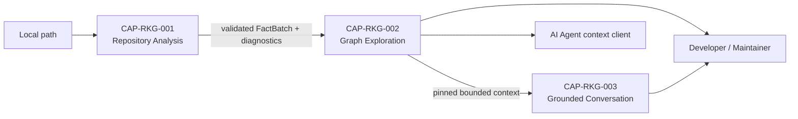

---
uid:
key: DGM-RKG-L1
type: diagram-view
group: derived
status: completed
revision: 2
scope: system
system: SYS-RKG
non_normative: true
hand_written: true
derived_from: [CAP-RKG-001, CAP-RKG-002, CAP-RKG-003]
---

> Bootstrap view viết tay. Khi sơ đồ và CAP normative bất đồng, CAP thắng; thay file
> này bằng output generator và bỏ `hand_written` khi generator sẵn sàng.

# L1 capability flow

