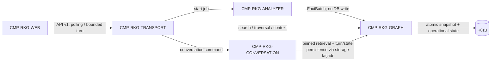

---
uid:
key: DGM-RKG-L2
type: diagram-view
group: derived
status: completed
revision: 2
scope: system
system: SYS-RKG
non_normative: true
hand_written: true
derived_from: [CMP-RKG-ANALYZER, CMP-RKG-GRAPH, CMP-RKG-TRANSPORT, CMP-RKG-WEB, CMP-RKG-CONVERSATION]
---

> Bootstrap view viết tay. Khi sơ đồ và CMP normative bất đồng, CMP thắng; thay file
> này bằng output generator và bỏ `hand_written` khi generator sẵn sàng.

# L2 component interaction

Single application process owns Kùzu writes in the MVP. Analyzer never imports or
executes repository source; Web never owns authoritative graph/history state.

