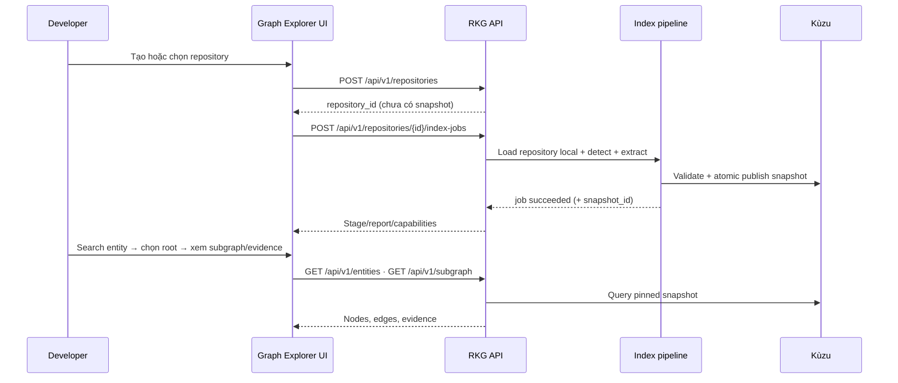
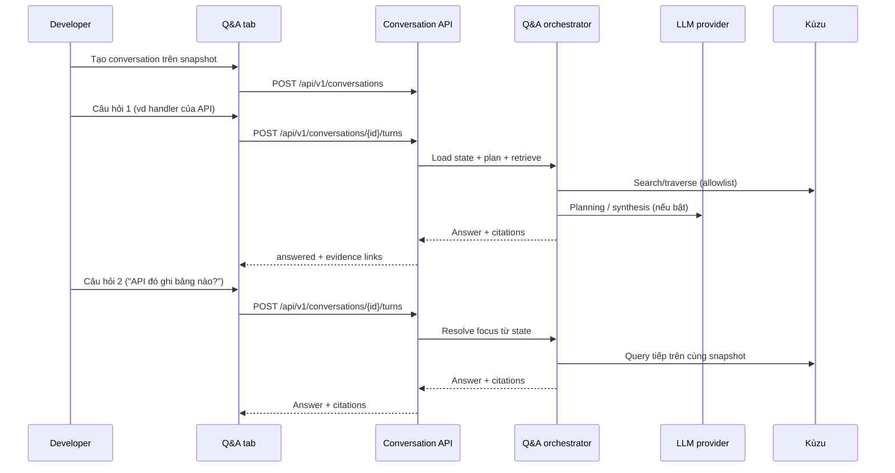

---

uid:
key: PRD-RKG
type: product-requirements-document
group: normative
scope: system
system: SYS-RKG
status: draft
revision: 22
ownership:
  accountable_team: TEAM-RKG
  accountable_role: product-owner
  affected_teams: []
relations:
  achieves: [GOAL-RKG-001, GOAL-RKG-002, GOAL-RKG-003, GOAL-RKG-004]
  measured_by: [OBS-RKG-001, OBS-RKG-002, OBS-RKG-005]
  constrained_by: [NFR-RKG-PERF-001, NFR-RKG-SEC-001, NFR-RKG-REL-001, NFR-RKG-UX-001, NFR-RKG-EXT-001]
verified_at: 2026-10-02
verified_against:
  - { key: CHG-RKG-2026-001, revision: 26 }
  - { key: BL-r1, revision: 1, note: "historical, superseded" }
  - { key: BL-r2, revision: 2, note: "candidate, not an approval" }
  - { key: OQ-RKG-001, revision: 3, note: "resolved" }
  - { key: OQ-RKG-002, revision: 6, note: "resolved" }
  - { key: OQ-RKG-006, revision: 3, note: "open; blocks current Scope and UI/UX approval" }
classification: internal
ai_assisted: true

---

# PRD-RKG - Repository Knowledge Graph

> **Biến một repository thành knowledge graph tĩnh có bằng chứng** — local-first; hỗ trợ nhiều ngôn ngữ và framework qua adapter; developer duyệt sơ đồ quan hệ trực quan, tìm kiếm và hỏi đáp có citation; AI Agent dùng cùng graph làm context có grounding — graph visualization phục vụ người dùng, không chỉ dành cho AI.

# I. THÔNG TIN TÀI LIỆU

| Trường              | Nội dung                                                                                                                                                                                                                      |
| ------------------- | ----------------------------------------------------------------------------------------------------------------------------------------------------------------------------------------------------------------------------- |
| **Loại tính năng**  | Platform Feature                                                                                                                                                                                                              |
| **Reviewers**       | Tech Lead (TEAM-RKG), QA Lead (TEAM-RKG), PM / Product Owner (TEAM-RKG)                                                                                                                                                       |
| **Epics liên quan** | `EPIC-001-TEAM-RKG` … `EPIC-005-TEAM-RKG` — Jira giữ state; nội dung từ FR/AC xuống                                                                                                                                           |
| **Nguồn**           | Normative `.aide/`. Các file `docs/SPEC.md`, `docs/ARCHITECTURE.md`, `docs/TASK.md`, `docs/RULES.md`, `docs/EXISTING_PRODUCT.md`, `docs/project-3.8-mvp.md` là nguồn lịch sử đã retire và không còn trong cây hiện tại. Chỉ `docs/reference/agentic-sdlc/` còn là tham chiếu quy trình, không phải product spec |

## Lịch sử thay đổi

| Version | Ngày      | Người thực hiện       | Mô tả thay đổi                                                                                |
| ------- | --------- | --------------------- | --------------------------------------------------------------------------------------------- |
| 0.1     | 15/9/2026 | PhongNM               | Tạo draft ban đầu                                                                             |
| 0.2     | 15/9/2026 | TrangHH               | Update thông tin                                                                              |
| 0.3     | 15/9/2026 | TrangHH               | Đồng bộ FR↔NFR (PERF/REL); cập nhật OQ-003; sửa typo                                          |
| 0.4     | 16/9/2026 | PhongNM               | Chuẩn hóa traceability, KPI precision và metadata                                             |
| 0.5     | 18/9/2026 | AI-assisted review    | Đóng gap review chéo về AC, KPI/eval, gate và traceability; chưa tự phê duyệt baseline        |
| 0.6     | 18/9/2026 | AI-assisted review v2 | Làm rõ app/adapter, scan outcomes, CLI, KPI Q&A và operational budgets; vẫn chờ ký Scope Gate |
| 0.7     | 18/9/2026 | AI-assisted           | **Bổ sung** FR-RKG-018 Repo History (không đổi FR/luồng cũ)                                   |
| 0.8     | 18/9/2026 | AI-assisted           | Thay Repo History bằng repository CRUD + snapshot lifecycle; bỏ entity Version                |
| 0.9     | 22/9/2026 | AI-assisted           | Bỏ input Git URL; mở rộng framing đa ngôn ngữ/framework; chỉ local path                       |
| 1.0     | 23/9/2026 | AI-assisted           | Tách goal extensibility; chuẩn hóa adapter contract và loại bỏ contract Git/ref còn sót       |
| 1.1     | 23/9/2026 | AI-assisted           | Chuẩn hóa công thức, tập mẫu, quy trình đo và điều kiện pass/fail cho từng KPI                 |
| 1.2     | 23/9/2026 | AI-assisted           | Bỏ KPI latency/RAM khỏi success metrics; giữ performance budgets tại NFR và benchmark tests    |
| 1.3     | 23/9/2026 | AI-assisted           | Chuyển adapter extensibility khỏi KPI/FR sang NFR-RKG-EXT-001                                  |
| 1.4     | 23/9/2026 | AI-assisted           | Gom 18 FR thành 5 capability; trung lập hóa ontology và tách MVP adapter profile                |
| 1.5     | 23/9/2026 | AI-assisted           | Sửa identity FR sau hợp nhất; đồng bộ lifecycle, gate, schema và signer governance              |
| 1.6     | 23/9/2026 | AI-assisted           | Siết OBS active, DoD/eval, OQ-006 và điều kiện publish khi parse lỗi                            |

# II. TỔNG QUAN (EXECUTIVE SUMMARY)

## 1. Tóm tắt tính năng

Repository Knowledge Graph (RKG) là công cụ local giúp developer và AI Agent hiểu codebase qua graph entity/relationship có bằng chứng source, không gắn cứng một ngôn ngữ hay framework. Người dùng đăng ký repository từ thư mục local trên máy, tạo snapshot bất biến bằng index/re-index, quản lý lịch sử snapshot theo repository, rồi tìm kiếm, duyệt subgraph trực quan và hỏi đáp tiếng Việt/Anh kèm citation. Graph Explorer phục vụ người đọc kiến trúc trực tiếp; AI Agent tái sử dụng cùng snapshot/evidence. Indexing và graph query không phụ thuộc LLM; tích hợp LLM là deliverable bắt buộc nhưng có thể tắt khi vận hành.

## 2. Vấn đề cần giải quyết (Problem Statement)

Khi tiếp nhận hoặc bảo trì một repository ứng dụng, developer và maintainer phải lần `endpoint → handler → dependency → service → DB/event` qua nhiều file mới nắm luồng dữ liệu.

**Pain point người dùng**

- Text search / IDE chủ yếu giúp ở mức symbol; khó trả lời câu hỏi kiến trúc có hướng (API này ghi bảng nào? Ai publish/consume topic? Sửa entity này ảnh hưởng gì?).
- Sản phẩm code intelligence lớn (ví dụ Sourcegraph) mạnh search/navigation quy mô lớn nhưng nặng, thiên enterprise/multi-repo — khó áp dụng cho dự án nhỏ cần công cụ local, single-repo.
- Chưa có sản phẩm đóng sẵn Graph Explorer mức kiến trúc ứng dụng (`API → DB → Event → Config → External Dependency`) chạy local, có evidence và sơ đồ để người dùng tự duyệt trên nhiều ngôn ngữ/framework.

**Pain point AI Agent**

- Context raw source dễ quá lớn, thiếu quan hệ có hướng, hoặc bịa khi thiếu bằng chứng và giới hạn rõ.

**Hậu quả:** onboarding chậm, review impact khó, agent thiếu grounding chung với những gì developer đang xem trên graph.

## 3. Mục tiêu kinh doanh (Business Goals)

| Goal key     | Mục tiêu                                                                                                                                                                                           | Liên kết OKR/KPI khối                                  |
| ------------ | -------------------------------------------------------------------------------------------------------------------------------------------------------------------------------------------------- | ------------------------------------------------------ |
| GOAL-RKG-001 | Giảm công sức lần theo mã nguồn thủ công khi tiếp nhận hoặc bảo trì repository, thông qua graph tĩnh có bằng chứng và snapshot nhất quán sau mỗi lần index từ thư mục local.                                      | N/A — định hướng: hỗ trợ hiểu codebase / Agentic SDLC  |
| GOAL-RKG-002 | Giảm thời gian trả lời câu hỏi kiến trúc thông dụng (endpoint → handler → dependency → DB/event/config) qua search, duyệt subgraph và lấy context JSON có budget từ cùng graph                     | N/A — định hướng: năng suất developer / maintainer     |
| GOAL-RKG-003 | Tăng độ tin cậy khi hỏi đáp về codebase: Q&A Việt/Anh nhiều lượt có citation từ graph; search/graph/history vẫn dùng được khi LLM tắt hoặc lỗi                                                     | N/A — định hướng: AI-assisted development có grounding |
| GOAL-RKG-004 | Giảm chi phí và rủi ro khi bổ sung ngôn ngữ/framework mới bằng adapter contract ổn định, không phải sửa core coordinator, graph schema hoặc public API                                          | NFR-RKG-EXT-001 — adapter extensibility                 |

## 4. Chỉ số thành công (Success Metrics / KPIs)

| KPI key     | Chỉ số                  | Công thức / đơn vị                                                                                              | Tập mẫu và cách đo                                                                                                                                                      | Baseline | Điều kiện đạt                                                                                                                  | Mốc      | Evidence    |
| ----------- | ----------------------- | --------------------------------------------------------------------------------------------------------------- | ---------------------------------------------------------------------------------------------------------------------------------------------------------------------- | -------- | ----------------------------------------------------------------------------------------------------------------------------- | -------- | ----------- |
| KPI-RKG-001 | Fixture extraction gate | `coverage = TP / (TP + FN)` và `precision = TP / (TP + FP)` theo fact canonical                                | Chạy toàn bộ golden fixtures của supported patterns; so sánh canonical entity/edge, attributes bắt buộc, rule và evidence với expected JSON                             | coverage 1.00, precision 1.00 (`TEST-RKG-FIXTURE-CENSUS-SUMMARY-001`) | Cả coverage và precision = 100%; không fixture bắt buộc nào fail                                                             | MVP (M5) | OBS-RKG-001 |
| KPI-RKG-002 | Pilot edge precision    | `precision_g = TP_g / (TP_g + FP_g)` cho từng nhóm edge `g`                                                     | Review census nếu population nhỏ hơn ngưỡng; nếu lớn hơn, lấy mẫu deterministic đã lưu seed: ≥30 import/call/DI và ≥10 cho từng DB/event/config/implements khi có dữ liệu | 1.00 / nhóm (`TEST-RKG-PILOT-REVIEW-SUMMARY-002`) | Mỗi nhóm được công bố ≥95%; thiếu sample phải ghi N/A/không đủ mẫu, không được gộp nhóm để pass                              | MVP (M5) | OBS-RKG-002 |
| KPI-RKG-005 | Q&A grounded quality    | Answerable accuracy; citation coverage/validity; graph-contradiction count; safety và conversation pass rate     | ≥30 câu độc lập (≥20 answerable, ≥5 insufficient/ambiguous, ≥5 injection) + ≥10 conversation 2–4 lượt + 1 conversation vượt history window; chấm bằng rubric cố định     | Chưa đo  | Accuracy ≥90%; citation coverage và validity 100%; 0 claim trái graph; safety và conversation pass rate 100%                 | MVP (M5) | OBS-RKG-005 |

`KPI-RKG-003`, `KPI-RKG-004` và `KPI-RKG-006` đã retired, không tái sử dụng ID.
Full-scan latency/RAM/query latency thuộc `NFR-RKG-PERF-001`; adapter extensibility
thuộc `NFR-RKG-EXT-001`. Chúng là quality gates, không phải product success KPI.

### Quy tắc đo chung

- Mỗi lần đo phải pin source snapshot/manifest, analyzer/schema/adapter version, test
  data revision, config và machine profile; không so sánh số từ hai profile khác nhau.
- Với extraction, `TP` là fact đúng contract, `FP` là fact thừa/sai và `FN` là fact
  expected bị thiếu; định nghĩa canonical match chi tiết nằm ở OBS-RKG-001/002.
- Lưu raw result và danh sách case/mẫu, không chỉ lưu kết luận pass/fail. Case bị loại
  phải có lý do trước khi xem kết quả; không loại outlier sau khi đo để đạt target.
- Target theo nhóm phải đạt ở từng nhóm/workload; không dùng trung bình tổng để che
  một nhóm fail. Không đủ sample là `N/A` hoặc `insufficient_sample`, không phải pass.
- KPI-RKG-005 vẫn `Chưa đo`. KPI-RKG-001 có baseline coverage 1.00 và precision 1.00 trên 6 fixture, 296 TP, 0 FN, 0 FP, ghi ở `TEST-RKG-FIXTURE-CENSUS-SUMMARY-001`; biên bản đó chưa có oracle review receipt. KPI-RKG-002 có baseline 1.00 trên từng nhóm của mẫu pilot digest `a094fc7b39def8636e2b73766d80510c4f4b917ea1da5a6e93e22619ef237417`, ghi ở `TEST-RKG-PILOT-REVIEW-SUMMARY-002`. Thay fixture, rubric hoặc measurement protocol phải tăng revision và không ghi đè evidence cũ.

# III. BỐI CẢNH VÀ PHÂN TÍCH

## 1. Đối tượng người dùng (Target Users)

| Persona                | Mô tả                                             | Pain points hiện tại                                            | Nhu cầu chính                                                     |
| ---------------------- | ------------------------------------------------- | --------------------------------------------------------------- | ----------------------------------------------------------------- |
| Developer mới          | Vừa vào dự án; cần hiểu endpoint và cấu trúc code | Mất thời gian lần handler/dependency qua nhiều file             | Tìm endpoint, xem handler, mở vị trí source                       |
| Maintainer / architect | Bảo trì và review thay đổi quanh API/DB/event     | Khó thấy caller, reads/writes, publisher/consumer có bằng chứng | Subgraph có hướng, evidence, dependency/technology report         |
| AI Agent client        | Tool/agent cần context giới hạn cho một tác vụ    | Context raw source dễ quá lớn hoặc thiếu quan hệ                | JSON entity/relationship/location/warning theo snapshot và budget |

## 2. Giả định (Assumptions)

- Repo đầu vào là working tree local; ngôn ngữ/framework được nhận diện qua registry adapter đã công bố; pattern ngoài contract báo diagnostic/`detected_only`, không đoán (FR-RKG-002).
- Người dùng tự chuẩn bị thư mục source trên máy; hệ thống không clone từ remote Git URL.
- Analyzer parse theo grammar/target đã pin cho từng language adapter; cú pháp ngoài phiên bản mục tiêu báo lỗi theo file.
- Một LLM provider adapter thật sẽ được cấu hình trước nghiệm thu live Q&A (OQ-RKG-001); trước đó mock đủ cho contract test.
- Pilot repository nhỏ đủ mẫu sẽ được chọn trước khi bắt đầu TASK-RKG-022 (OQ-RKG-002).

## 3. Ràng buộc (Constraints)

- Không import, cài dependency, chạy build backend hoặc thực thi source của repo đầu vào.
- Chỉ local single-user (loopback); không public deployment, SSO, RBAC, multi-tenant trong MVP.
- Deep extraction chỉ chạy khi có adapter/version/pattern tương ứng; stack chưa có deep adapter tối đa `detected_only`.
- Core analyzer, graph schema và public API không phụ thuộc Python/FastAPI; Python 3.12, FastAPI, SQLAlchemy 2.x và aiokafka là bộ adapter deep-supported đầu tiên của MVP.
- Full rebuild only; catalog có thể đăng ký nhiều repository độc lập nhưng không có
graph/query xuyên repository, incremental indexing hoặc graph xuyên service.
- Mọi fact resolve được phải có rule/evidence; không đoán edge; không lưu secret/config value/raw source hoặc transcript trong operational log. Conversation history đã redact được lưu trong conversation store theo FR-RKG-005.

## 4. Phụ thuộc (Dependencies)

| Dependency                       | Loại               | Team chịu trách nhiệm | Trạng thái / ETA                                                      |
| -------------------------------- | ------------------ | --------------------- | --------------------------------------------------------------------- |
| Kùzu embedded                    | Graph store        | TEAM-RKG              | Chọn phiên bản ở T-01                                                 |
| React + Vite (UI)                | Frontend toolchain | TEAM-RKG              | T-01 / T-17                                                           |
| LLM provider API (một adapter)   | 3rd party          | TEAM-RKG              | OQ-RKG-001 → T-19                                                     |
| Historical `docs/SPEC.md` | Retired source | TEAM-RKG | File không còn trong cây. Contract hiện tại là FR-RKG-001 và ADR-2026-004 |

# IV. YÊU CẦU TÍNH NĂNG

## 1. Trong phạm vi (In Scope)

- Catalog repository local: CRUD metadata/defaults cho nguồn thư mục local; source identity bất biến.
- Một repository có nhiều snapshot bất biến; list/detail/activate/delete có reference guards; không có entity Version riêng.
- Static graph dùng canonical entity trung lập (`Directory`, `SourceUnit`, `Type`, `Callable`, `Endpoint`, `DataResource`, `MessageChannel`, `Configuration`, `ExternalDependency`) và adapter contract đa ngôn ngữ/framework. Bộ adapter Python/FastAPI/SQLAlchemy/aiokafka chỉ là profile triển khai đầu tiên của MVP.
- Full rebuild index, atomic snapshot, scan report, diagnostics.
- Search, traversal, context JSON API; local Graph Explorer UI.
- CLI `rkg index` và `rkg serve` dùng cùng application services/contract với API; server mặc định bind loopback.
- LLM Q&A Việt/Anh nhiều lượt, citation, conversation history bền vững; LLM có thể tắt.

## 2. Ngoài phạm vi (Out of Scope)

- Nhận source bằng Git URL/remote clone; người dùng phải trỏ tới working tree local đã có sẵn.
- Cam kết deep coverage đồng đều mọi ngôn ngữ/framework ngay từ đầu; ngoài adapter đã công bố chỉ `detected_only` hoặc diagnostic.
- Deep adapter ngoài registry đã công bố; SQL text; DB introspection; column lineage; runtime broker/trace.
- Đọc `.env`, lưu config values, suy luận secret hoặc URL động từ config.
- Embedding/vector DB; LLM tự tạo graph fact; autonomous coding; MCP; memory xuyên conversation/repo.
- Git OAuth org browse, MR/PR integration, submodule/LFS content, incremental index,
graph/query xuyên repository, cloud/SSO.
- SSE/WebSocket/token streaming và desktop wrapper trong API v1; quyết định và điều kiện versioning nằm ở `ADR-2026-003` và `API-RKG-CORE-v1`.

## 3. Danh sách tính năng (Feature List)

| Biz Process        | FR key     | Tên capability                                  | Mô tả ngắn                                                        | Priority  | Milestone | Link ticket                            |
| ------------------ | ---------- | ----------------------------------------------- | ----------------------------------------------------------------- | --------- | --------- | -------------------------------------- |
| Repository lifecycle | FR-RKG-001 | Quản lý repository, index job và snapshot     | Local catalog, job/report, atomic publish và lifecycle guards     | Must Have | M0–M3     | EPIC-001/002/003-TEAM-RKG              |
| Static analysis      | FR-RKG-002 | Phân tích repository thành evidence graph      | Adapter pipeline, canonical entity/edge, detection và evidence    | Must Have | M1–M2     | EPIC-001/002/003-TEAM-RKG              |
| Explore              | FR-RKG-003 | Tìm kiếm và khám phá graph                     | Search, traversal, visualization, evidence và support state       | Must Have | M0/M2/M3  | EPIC-001/002/003-TEAM-RKG              |
| Context              | FR-RKG-004 | Trích xuất bounded context                     | JSON deterministic có snapshot, budget và truncation              | Must Have | M2        | EPIC-002-TEAM-RKG                      |
| Grounded Q&A         | FR-RKG-005 | Grounded Q&A nhiều lượt                        | Citation, clarification, history và snapshot pin                  | Must Have | M4        | EPIC-004-TEAM-RKG                      |

Các FR cũ 006–018 được hợp nhất theo mapping: `006→003`, `007→004`,
`008/016/018→001`, `009–014→002`, `015/017→005`. AC giữ nguyên ID để bảo toàn
traceability; approval/baseline lịch sử vẫn giữ khóa FR tại thời điểm ký.

## 4. Yêu cầu phi chức năng (Non-functional Requirements)

| NFR key          | Loại        | Mô tả ngắn                                                          | Áp lên                              | Ghi chú                |
| ---------------- | ----------- | ------------------------------------------------------------------- | ----------------------------------- | ---------------------- |
| NFR-RKG-PERF-001 | Performance   | Ngân sách thời gian/RAM scan và latency query trên máy tham chiếu   | FR-RKG-001, 003, 004           | Con số sống ở file NFR |
| NFR-RKG-SEC-001  | Security      | Local loopback, allowlist, không thực thi source, không lộ secret   | FR-RKG-001, 002, 004, 005      | Security / privacy     |
| NFR-RKG-REL-001  | Reliability   | Một writer; repository ownership; atomic snapshot; pin conversation | FR-RKG-001–005                  | Consistency            |
| NFR-RKG-UX-001   | Usability     | Luồng chính tự giải thích; lifecycle safety; a11y; sanitize output  | FR-RKG-001, 003, 005           | Design                 |
| NFR-RKG-EXT-001  | Extensibility | Adapter mới không yêu cầu sửa core/schema/public API                | FR-RKG-002                     | Adapter conformance    |

# V. LUỒNG NGƯỜI DÙNG (USER FLOWS)

## 1. Luồng chính

### 1.1 Repository local → index → snapshot → Explorer

1. Developer tạo repository từ thư mục local hoặc chọn repository đã đăng ký.
2. Create chỉ đăng ký source; developer chủ động tạo index job cho repository.
3. Hệ thống validate local path, detect ngôn ngữ/framework và extract graph.
4. Snapshot mới hợp lệ được publish nguyên tử và trở thành active của repository; UI hiện stage/report.
5. Developer tìm entity, duyệt subgraph và mở evidence/source location.

### 1.2 Q&A nhiều lượt có citation

1. Developer tạo conversation gắn một snapshot.
2. Câu hỏi được resolve qua history/state + graph retrieval; answer kèm citation.
3. Follow-up dùng focus/pending clarification; không yêu cầu gửi lại transcript.
4. Khi LLM tắt/lỗi, search/graph và đọc history vẫn dùng được.

### 1.3 Quản lý repository và snapshot (FR-RKG-001)

1. Developer mở **Repositories**, tạo/xem/sửa metadata/defaults hoặc chọn repository.
2. Repository detail hiển thị active snapshot và snapshot history newest-first.
3. Developer có thể activate snapshot retained để mở Explorer mà không re-index.
4. Snapshot delete bị chặn nếu active, có reader hoặc conversation reference.
5. Repository delete bị chặn nếu có job/reader/conversation; nếu hợp lệ mới cascade dữ liệu con.
6. Đổi active snapshot không đổi snapshot pin của conversation cũ.

## 2. Edge Cases và Error States

| Tình huống                                                  | Hành vi mong muốn                                                                                  |
| ----------------------------------------------------------- | -------------------------------------------------------------------------------------------------- |
| Local path ngoài allowlist / không tồn tại / symlink escape | Job hoặc đăng ký `failed` với mã lỗi riêng; không publish; filesystem người dùng không bị sửa      |
| Parse lỗi một phần file                                     | Diagnostic theo file; chỉ publish kèm warning khi application entrypoint vẫn resolve và candidate graph còn validate |
| Application entrypoint không resolve / nhiều app candidate  | Không đoán; `app_unresolved` hoặc `app_selection_required`; đúng một app được chọn tự động         |
| Nhiều technology/deep adapter hợp lệ                        | Publish tất cả detection/capability có evidence; không ép chọn một adapter thắng                   |
| Vượt `max_files` / một file quá lớn                         | Vượt `max_files` làm job `failed`; file quá lớn bị skip + warning, phần còn lại vẫn có thể publish |
| Index lỗi sau khi đã có snapshot                            | Giữ active snapshot cũ; UI vẫn mở được graph cũ                                                    |
| Entity mơ hồ khi Q&A                                        | `needs_clarification` + candidates; không tự chọn                                                  |
| Thiếu evidence / detected_only                              | `insufficient_evidence` hoặc limitations rõ; không bịa absence thành “không dùng”                  |
| Prompt injection trong repo/câu hỏi                         | Không kích hoạt shell/network/code ngoài allowlist read-only                                       |
| Hai tab cùng conversation                                   | `409 conversation_conflict` / idempotency; không duplicate turn                                    |
| Update repository revision cũ                               | `409 repository_conflict`; reload state và không apply mutation một phần                           |
| Xóa snapshot active/đang dùng                               | `409 snapshot_active`/`snapshot_in_use`; không xóa một phần                                        |
| Xóa repository đang bận/được tham chiếu                     | `409 repository_busy`/`repository_in_use`; không cascade một phần                                  |
| Activate snapshot cũ                                        | Đổi active pointer của đúng repository; không tạo job hoặc đổi conversation pin                    |
| Repository/snapshot ownership mismatch                      | `404` chung; không lộ metadata repository khác                                                     |

# VI. DEFINITION OF DONE (DoD)

- [ ] Mọi FR `approved`; OQ-RKG-001 và OQ-RKG-002 đã resolved; OQ-RKG-006 còn mở và chặn ký candidate Scope/UIUX, không chặn nội dung FR
- [ ] Coverage pass: FR→AC, AC→implementation_target, KPI→OBS
- [ ] Fixture gate AC tương ứng đạt; pilot/Q&A eval theo OBS-RKG-001/002/005 và `EVAL-RKG-QA-001`, benchmark theo NFR-RKG-PERF-001 và adapter conformance theo NFR-RKG-EXT-001 đã ghi evidence
- [ ] README cho phép người khác cài, index fixture, mở UI, lấy context
- [ ] LLM tắt hoặc lỗi: graph/search/history đọc vẫn hoạt động
- [ ] Scan không thực thi/sửa source đầu vào; không lộ secret trong store/log
- [ ] Repository CRUD và snapshot activate/delete đạt ownership/reference-guard tests

# VII. THIẾT KẾ VÀ MOCKUPS

| Màn hình / Flow                  | Link Figma / Mô tả                                                                 |
| -------------------------------- | ---------------------------------------------------------------------------------- |
| Onboarding + job status          | `design/ux/UXF-RKG-001.md`, `design/ui/UID-RKG-001.md`, `design/ux/SCR-RKG-001.md` |
| Graph Explorer + evidence        | `design/ux/UXF-RKG-001.md`, `design/ui/UIS-RKG-001.md`                             |
| Q&A / conversation               | `design/ux/UXF-RKG-002.md`, `design/ui/UIS-RKG-001.md`                             |
| Repository / snapshot management | `design/ux/UXF-RKG-003.md`, `design/ui/UIS-RKG-001.md`                             |

# VIII. TIMELINE VÀ PHASING

| Phase           | Nội dung                    | Target Release                                      | Must Have features (FR keys)    |
| --------------- | --------------------------- | --------------------------------------------------- | ------------------------------- |
| Phase 1 / M0    | MVP giao diện (fixture)     | Theo TASK giai đoạn I                               | FR-RKG-001, 003                  |
| Phase 2 / M1–M2 | Source + full graph + API   | Theo TASK giai đoạn II                              | FR-RKG-001–004                  |
| Phase 3 / M3    | Explorer tích hợp API thật  | Theo TASK giai đoạn III                             | FR-RKG-001–003                  |
| Phase 4 / M4–M5 | Q&A nhiều lượt + nghiệm thu | Theo EPIC-004/005 (M4: Q&A; M5: nghiệm thu)         | FR-RKG-005 + toàn bộ AC         |

**Rollout Strategy:** Local single-user; không feature flag % user. LLM mặc định tắt; bật bằng cấu hình vận hành. Chi tiết release ở `lifecycle/releases/` khi tới bước Release prep.

FR-RKG-001 có UI mock ở TASK-RKG-025, storage/API ở TASK-RKG-013/015/016 và live integration ở TASK-RKG-024.

# IX. PHÊ DUYỆT — Scope Gate

| Vai trò                 | Họ tên | Ngày review | Quyết định | Ghi chú            |
| ----------------------- | ------ | ----------- | ---------- | ------------------ |
| PM / Product Lead (PIC) |        |             |            | Draft — chờ review |
| Tech Lead               |        |             |            |                    |
| QA Lead                 |        |             |            |                    |

- `ai_assisted`: true
- **Người chịu trách nhiệm cuối:** Product Owner TEAM-RKG
- **Baseline:** `approval-004` khóa `PRD-RKG` revision 16 cùng bộ FR lúc đó. `BL-r1` là pin historical/superseded; danh sách artifact của pin đó vẫn gồm FR-RKG-006…018 dù các file đó không còn. `BL-r2` là candidate working baseline, không phải approval. Revision 20 của file này chưa được Scope Gate ký lại. Revision 19 ghi `BL-r2` như pin đang active; câu đó không còn dùng.

## Open Questions

Câu đang mở: chỉ `OQ-RKG-006`. `OQ-RKG-001` và `OQ-RKG-002` đã resolved và không nằm trong current-open list.

| OQ key     | Câu hỏi                                                                                                                             | Owner         | Due                            | Trạng thái                                                         |
| ---------- | ----------------------------------------------------------------------------------------------------------------------------------- | ------------- | ------------------------------ | ------------------------------------------------------------------ |
| OQ-RKG-001 | Chọn LLM provider/model/credential/tokenizer thật cho T-19 và live eval                                                             | Tech Lead     | Trước T-19 live eval           | Resolved — OpenRouter, `openai/gpt-4o-mini`; không còn mở          |
| OQ-RKG-002 | Chọn pilot đủ mẫu theo quy tắc KPI-RKG-002; nhóm không xuất hiện được ghi N/A và vẫn phải đạt fixture riêng                         | Product Owner | Trước khi bắt đầu TASK-RKG-022 | Resolved — `TEST-RKG-PILOT-CORPUS-002`; không còn mở               |
| OQ-RKG-003 | Đã tạo OBS cho KPI-RKG-001, 002 và 005 (`OBS-RKG-001`, `002`, `005`); KPI-003/004/006 đã retired                                    | Tech Lead     | —                              | Resolved — không còn block KPI measured_by                         |
| OQ-RKG-004 | Snapshot DELETE thành công biến mất khỏi list; `410` chỉ dùng khi metadata/reference còn biết nhưng payload mất ngoài lifecycle API | Product Owner | —                              | Resolved — FR-RKG-001/API revision hiện tại                        |
| OQ-RKG-005 | Có cần RepositoryVersion giữa Repository và Snapshot không?                                                                         | Product Owner | —                              | Resolved — không; dùng Repository 1—N Snapshot theo ADR-2026-004   |
| OQ-RKG-006 | Ai là danh tính người ký Scope/UIUX candidate baseline hiện tại?                                                                    | Product Owner | Trước khi ký lại Scope/UIUX    | Open — chặn approval Scope và UI/UX hiện tại; gate vẫn pending     |

---

## Tài liệu liên quan

- FR/AC đầy đủ ở `requirements/fr/FR-RKG-*.md` (không giữ bản sao ở đây).
- NFR ở `requirements/nfr/`.
- Domain glossary ở `domain/`.
- L1/L2 ở `architecture/`.
- Quyết định kiến trúc ở `architecture/adr/`.
- Gate checklist ở `policies/gates/`; eval rubric ở `policies/eval/`.
- Threat model ở `architecture/threat-model/`.
- Đo lường (OBS): `observability/OBS-RKG-001.md`, `OBS-RKG-002.md`, `OBS-RKG-005.md` (OQ-RKG-003 đã resolve).
- Change Set MVP: `lifecycle/change-sets/CHG-RKG-2026-001/`.
- Nguồn ý định sản phẩm gốc từng nằm ở `docs/SPEC.md`, `docs/TASK.md`, `docs/ARCHITECTURE.md`. Các path đó đã retire. Authority hiện tại là artifact trong `.aide/`.

## Directory graph revision - implementation verification

Repository is the persistent graph root. Core derives Directory nodes from emitted
source-unit paths; adapters emit source and semantic facts. New snapshots retire
Namespace nodes while keeping module/package metadata and resolution. Structure
uses canonical Directory entities. Previously published snapshots stay readable.
This current revision requires review; historical approval and verification do not
approve it. The user confirmed code work on 2026-10-01; implementation verification
is recorded in TEST-RKG-DIRECTORY-IMPLEMENTATION-001. This does not imply gate approval.

## Revision 20

Documentation check on 2026-10-02 against Change Set revision 26, superseded
`BL-r1`, candidate `BL-r2`, and OQ-RKG-001/002/006. `verified_at` records that
check. It is not a Scope Gate signature. Revision 19 remains the prior text
except for the fields and sections named above.
