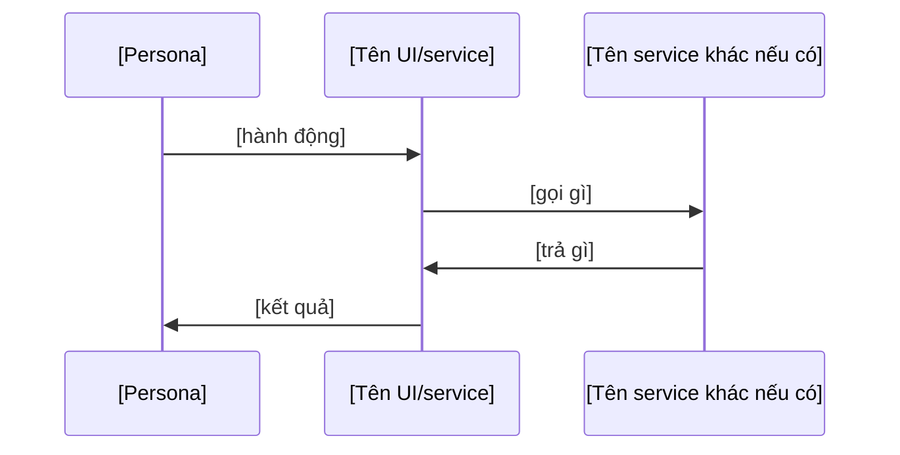

<!-- Template này giữ khung I–IX của PRD hiện hành (current-templates/prd-template-product-requirement-document.md),
     bổ sung machinery của process: FR/AC có key, NFR/telemetry chỉ reference, OQ có owner+due. -->

# PRD — [Tên tính năng]

> **[Tuyên bố giá trị một câu]** — [bổ sung ngắn nếu cần, vd phạm vi/đối tượng chính].

# I. THÔNG TIN TÀI LIỆU

<!-- Phần lớn thông tin quản trị đã nằm ở frontmatter (một nguồn sự thật). Giữ lại phần frontmatter không cover: -->

| Trường | Nội dung |
|---|---|
| **Loại tính năng** | [Platform Feature / Mini App Feature / Cross-cutting Feature] |
| **Reviewers** | [Tech Lead (X), QA Lead (Y), PM (Z)] |
| **Epics liên quan** | [EPIC-xxx — Jira giữ state, nội dung từ FR/AC xuống] |
| **Nguồn** | [tài liệu gốc PRD này dựa trên — proposal, vision, spec ngoài — path/link + mục cụ thể] |

## Lịch sử thay đổi

| Version | Ngày | Người thực hiện | Mô tả thay đổi |
|---|---|---|---|
| 0.1 | [ngày] | [người] | Tạo draft ban đầu |

# II. TỔNG QUAN (EXECUTIVE SUMMARY)

## 1. Tóm tắt tính năng

[3–5 câu: tính năng là gì, cho ai, tại sao, kỳ vọng — không jargon kỹ thuật.]

## 2. Vấn đề cần giải quyết (Problem Statement)

[Pain point kèm data/user insight. Ai gặp vấn đề gì, hậu quả gì.]

## 3. Mục tiêu kinh doanh (Business Goals)

<!-- Mỗi goal một key — FR sẽ satisfies về đây -->

| Goal key | Mục tiêu | Liên kết OKR/KPI khối |
|---|---|---|
| GOAL-[SYSTEM]-001 | [đo lường được, vd: tăng tỷ lệ hoàn thành thanh toán 72% → 85% trong Q3] | [OKR] |

## 4. Chỉ số thành công (Success Metrics / KPIs)

<!-- Cách đo KHÔNG mô tả ở đây — measured_by trỏ tới OBS (coverage luật 5).
     Cột "Giải thích" chỉ nói RÕ đơn vị/phạm vi đo (vd "% trên tổng finding High/Critical"),
     không lặp lại công thức/số đã sống ở OBS. -->

| KPI key | KPI | Giải thích | Baseline | Target | Timeline | measured_by |
|---|---|---|---|---|---|---|
| KPI-[SYSTEM]-001 | [tên] | [đo trên cái gì, đơn vị nào] | [hiện tại] | [mục tiêu] | [quý] | OBS-[SYSTEM]-001 |

[Nếu KPI cần một số lượng mẫu tối thiểu mới có nghĩa (vd precision %), ghi rõ ngưỡng — vd "không quote % khi chưa có ≥N mẫu đã adjudicate, trước đó report counts".]

# III. BỐI CẢNH VÀ PHÂN TÍCH

## 1. Đối tượng người dùng (Target Users)

| Persona | Mô tả | Pain points hiện tại | Nhu cầu chính |
|---|---|---|---|
| [tên] | [độ tuổi, nghề nghiệp, hành vi] | [vấn đề] | [muốn gì] |

## 2. Giả định (Assumptions)

- [giả định — nếu sai thì FR nào phải re-evaluate]

## 3. Ràng buộc (Constraints)

- [điều KHÔNG THỂ đổi: kỹ thuật, pháp lý, timeline, ngân sách]

## 4. Phụ thuộc (Dependencies)

| Dependency | Loại | Team chịu trách nhiệm | Trạng thái / ETA |
|---|---|---|---|
| [tên — nếu là contract thì ghi key: API-xxx-v2] | [Platform SDK / Backend API / 3rd party] | TEAM-[...] | [Available / In dev / Pending] |

# IV. YÊU CẦU TÍNH NĂNG

## 1. Trong phạm vi (In Scope)

- [capability]

## 2. Ngoài phạm vi (Out of Scope)

- [capability X — làm ở PRD khác / phase 2. Quan trọng ngang phần In để chống scope creep]

## 3. Danh sách tính năng (Feature List)

<!-- Cột FR key thay cột # — mỗi FR một file riêng theo fr.md, đây chỉ là chỉ mục.

     Cột "Biz Process" là NHÃN TỔ CHỨC, không phải artifact: gom các FR thuộc cùng một
     luồng nghiệp vụ để đọc và để mở Jira Epic tương ứng, viết TRƯỚC Scope Gate lúc FR
     còn đang soạn. Không có key, không vào metadata graph, không artifact nào khác
     `relations` tới nó — đổi tự do, không qua change request.

     ĐỪNG nhầm với Epic (PROC §2.2.5): Epic là đơn vị GIAO VIỆC theo team + Change Set,
     do Tech Lead tạo ở bước Planning (EXEC B.9), SAU khi FR/AC đã qua Scope Gate.
     Biz Process trả lời "nhóm tính năng nào", Epic trả lời "ai làm, chặn bởi gì".

     Một nhãn Biz Process lặp lại ổn định qua nhiều PRD/Phase là tín hiệu nên nâng thành
     CAP (L1, cạnh `covers: FR`, Architect chốt) — không tự tạo type mới cho nó. -->

| Biz Process | FR key | Tên tính năng | Mô tả ngắn | Priority (MoSCoW) | Milestone | Link ticket |
|---|---|---|---|---|---|---|
| [nhãn nghiệp vụ — vd "Đăng ký & xác thực"] | FR-[SYSTEM]-001 | [tên] | [mô tả] | Must Have | [M1/M2/... nếu PRD có milestone] | [EPIC-xxx — có thể để trống nếu Epic chưa tạo] |

## 4. Yêu cầu phi chức năng (Non-functional Requirements)

<!-- Chỉ reference — con số sống ở artifact NFR (NT-01). KHÔNG gõ lại "P95 < 500ms" vào đây.
     Cột "Mô tả ngắn" chỉ là câu định hướng đọc (không số), để không phải mở từng file NFR mới biết áp cái gì. -->

| NFR key | Loại | Mô tả ngắn | Áp lên | Ghi chú |
|---|---|---|---|---|
| NFR-[...]-PERF-[NN] | Performance | [một câu, không số] | [FR/AC nào] | refine từ NFR-ORG-[...] |
| NFR-[...]-SEC-[NN] | Security | [một câu, không số] | [...] | Security sở hữu |

# V. LUỒNG NGƯỜI DÙNG (USER FLOWS)

## 1. Luồng chính

<!-- Vẽ bằng Mermaid sequenceDiagram (diagram-as-code — cùng chuẩn Danh Mục Tiêu Chuẩn
     Diagram dùng ở L1/L2/L3), kèm mô tả từng bước bằng lời ngay dưới mỗi diagram (đọc
     nhanh không cần dịch ký hiệu sequence diagram). Luồng chính có thể gồm nhiều luồng
     nhỏ (1.1, 1.2, ...) — mỗi actor/kịch bản khác biệt (persona khác, điểm vào khác,
     happy path vs biến thể chính) một mục con, mỗi mục một sequenceDiagram + mô tả
     bước riêng. Chỉ một luồng: giữ một mục 1.1 duy nhất, xoá các mục 1.2+ mẫu dưới đây.

     Nếu luồng (hoặc một đoạn của luồng) đã có sequence diagram chi tiết ở tài liệu L2/L3
     (component-level) — TRỎ LINK tới đó, không vẽ lại (NT-01). PRD chỉ giữ mức đủ để
     người đọc hiểu who-does-what-when; chi tiết kỹ thuật (payload, retry, lock) thuộc L2/L3. -->

### 1.1 [Tên luồng — vd "Luồng chính qua UI"]

1. [User làm gì — bước khớp với mũi tên đầu tiên trong diagram]
2. [bước tiếp theo]
3. [kết quả cuối]

### 1.2 [Tên luồng khác — thêm mục con nếu cần, xoá dòng này nếu chỉ có một luồng]

[sequenceDiagram tương tự, hoặc "xem chi tiết ở `architecture/l2/[CMP-...].md` §[mục]"]

## 2. Edge Cases và Error States

| Tình huống | Hành vi mong muốn |
|---|---|
| [mất mạng giữa chừng] | [error message, retry, không trừ tiền] |

# VI. DEFINITION OF DONE (DoD)

<!-- Chỉ điều kiện cross-cutting; điều kiện riêng từng FR nằm ở AC của FR đó -->

- [ ] Mọi FR `approved`, không FR nào bị OQ mở block (coverage luật 7)
- [ ] Coverage pass: FR→AC, AC→implementation_target, KPI→OBS
- [ ] [điều kiện nghiệp vụ cross-cutting khác]

# VII. THIẾT KẾ VÀ MOCKUPS

| Màn hình / Flow | Link Figma / Mô tả |
|---|---|
| [tên] | [link] |

# VIII. TIMELINE VÀ PHASING

| Phase | Nội dung | Target Release | Must Have features (FR keys) |
|---|---|---|---|
| Phase 1 (MVP) | [core] | [Q3] | FR-[...], FR-[...] |

**Rollout Strategy:** [feature flag, % user, A/B — chi tiết ordering/rollback ở Release Plan (§3.4.3)]

# IX. PHÊ DUYỆT — Scope Gate

| Vai trò | Họ tên | Ngày review | Quyết định | Ghi chú |
|---|---|---|---|---|
| PM / Product Lead (PIC) | | | Approved / Changes needed | |
| Tech Lead | | | | |
| QA Lead | | | | |

- `ai_assisted`: [true/false — đã khai ở frontmatter]
- **Người chịu trách nhiệm cuối:** [tên/role — nếu quyết định ký ở cấp business sponsor thay vì một trong các role ở bảng trên, ghi rõ tên + thời điểm ký ở đây, không tự gán vào một role của bảng]
- **Baseline được duyệt:** [`key` PRD + revision] + [danh sách từng FR/NFR đã duyệt cùng lần này, kèm revision tại thời điểm ký — không chỉ một `BL-key` chung, để biết chính xác bản nào đã chốt]. Sau gate, **chỉ Product** được đổi AC, qua change request (§1.4.2).

## Open Questions

| OQ key | Câu hỏi | Owner | Due | Blocking |
|---|---|---|---|---|
| OQ-[SYSTEM]-001 | [câu hỏi] | [người] | [ngày] | FR-[...] |

<!-- OQ đã trả lời: gạch ngang câu hỏi cũ + thêm câu trả lời với ✅, GIỮ lại dòng (đừng xoá) — lịch sử trả lời là bằng chứng, không phải rác. -->

---

## Tài liệu liên quan

<!-- Index link ra artifact khác — không chép nội dung (NT-01). Xoá dòng nào không áp dụng, thêm dòng nếu PRD có artifact loại khác. -->

- FR/AC đầy đủ ở `requirements/fr/FR-[SYSTEM]-*.md` (không giữ bản sao ở đây).
- NFR ở `requirements/nfr/`.
- Domain glossary ở `domain/`.
- L1 (capability map) và L2 (component design) ở `architecture/`.
- Quyết định kiến trúc nền ở `architecture/adr/`.
- Threat model ở `architecture/threat-model/`.
- Đo lường ở `observability/`.
- Rule/gate/eval-spec ở `policies/`.
- Tầm nhìn dài hạn (không phải AC của phase này) ở `product/vision/`.
 